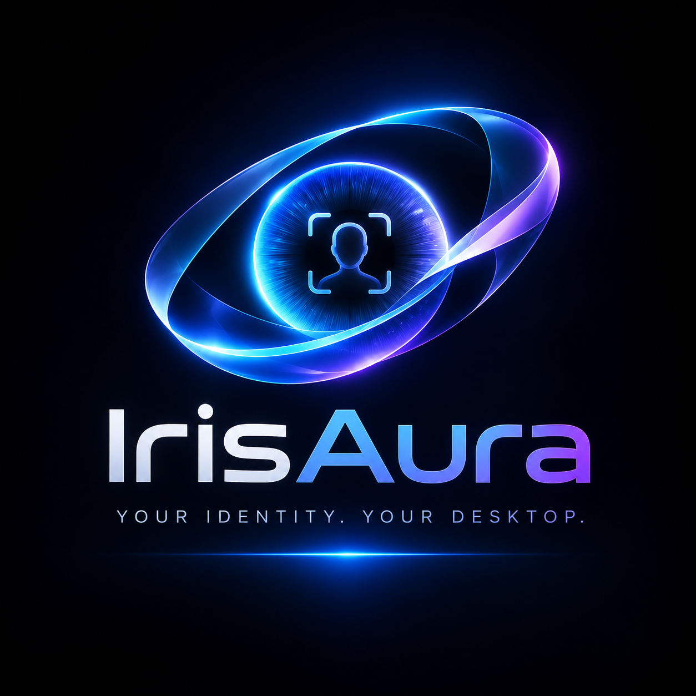

<p align="center">
  
</p>

<p align="center"><b>Your identity. Your desktop.</b></p>

IrisAura is a Windows desktop product with two parts:

| Product | What it is | Status |
|---|---|---|
| **IrisAura Island** | A compact, animated activity surface at the top-centre of the screen: now playing with live waveform, volume/brightness HUDs, charging, Bluetooth, mic/camera indicators, timers, downloads, notifications, and an SDK so any app can show its own activity. | First release target |
| **IrisAura Face Lab** | Local face-recognition research tool: camera diagnostics, enrolment, detection and recognition experiments. | Research build; **not** an authentication factor |
| **IrisAura Face Sign-in** | Experimental Windows sign-in research track. | Gated: ships only if every feasibility and security gate passes. **Windows Hello remains the recommended way to sign in.** |

> IrisAura recognises **faces**, not irises. "Iris" is part of the name only.

## Project status

**Phase 0A — repository and development environment.** No user-facing features yet.
Progress is tracked in [docs/PROGRESS.md](docs/PROGRESS.md); the full plan is in
[docs/BLUEPRINT.md](docs/BLUEPRINT.md).

## Honest limits

- The Island cannot appear on the Windows lock screen, and cannot accept or decline calls in other apps.
- Face recognition with an ordinary webcam is a convenience/demo feature, not security. No false-accept rate is claimed until it has been measured under a documented protocol.
- Custom Windows sign-in may be cancelled if its feasibility gates fail. That is an acceptable outcome.

## Repository layout

```
IrisAura.sln               full solution (C# + native); open in Visual Studio
IrisAura.Managed.slnf      C#-only filter used by the dotnet CLI and scripts/build.ps1
src/                       C# projects (Island, Face, shared)
native/                    C++ projects (inert credential-provider skeleton)
tests/                     unit and architecture tests
assets/brand/              original logos (do not edit) + source SVGs
docs/                      blueprint, decisions, progress, security and privacy docs
scripts/                   build, brand-asset and dev-certificate scripts
models/  packaging/  installer/   placeholders for later phases
```

## Building

**Requirements**

| Tool | Needed for |
|---|---|
| .NET 10 SDK (pinned in `global.json`) | all C# projects |
| Visual Studio 2026 (or a supported version) with *Desktop development with C++*, MSVC x64 + ARM64 tools and a Windows 11 SDK | native projects |
| ImageMagick 7 (`magick` on `PATH`) | `scripts/build-brand-assets.ps1` only |

**Build and test**

```powershell
./scripts/build.ps1            # restore, build (warnings are errors) and test; builds native too if MSVC is found
./scripts/build.ps1 -SkipNative
```

Or directly:

```powershell
dotnet build IrisAura.Managed.slnf -c Release
dotnet test  IrisAura.Managed.slnf -c Release
```

## Documentation

| Document | Purpose |
|---|---|
| [BLUEPRINT.md](docs/BLUEPRINT.md) | Source of truth: architecture, phases, gates |
| [PROGRESS.md](docs/PROGRESS.md) | Phase-by-phase evidence |
| [DECISIONS/](docs/DECISIONS/) | Architecture decision records |
| [HARDWARE_MATRIX.md](docs/HARDWARE_MATRIX.md) | What was tested on which device |
| [KNOWN_ISSUES.md](docs/KNOWN_ISSUES.md) | Open issues and limitations |
| [THREAT_MODEL.md](docs/THREAT_MODEL.md), [SECURITY_REVIEW.md](docs/SECURITY_REVIEW.md) | Security |
| [PRIVACY.md](docs/PRIVACY.md), [RECOVERY.md](docs/RECOVERY.md) | Privacy and sign-in recovery |
| [DEPENDENCIES.md](docs/DEPENDENCIES.md) | Generated dependency inventory |

## Security

Please report vulnerabilities privately; see [SECURITY.md](SECURITY.md).

## Licence

Proprietary — all rights reserved. See [LICENSE](LICENSE). Third-party components keep their own
licences; see [THIRD_PARTY_NOTICES.md](THIRD_PARTY_NOTICES.md).

Windows, Windows Hello and Xbox are trademarks of Microsoft Corporation. IrisAura is not affiliated
with or endorsed by Microsoft or Apple.
