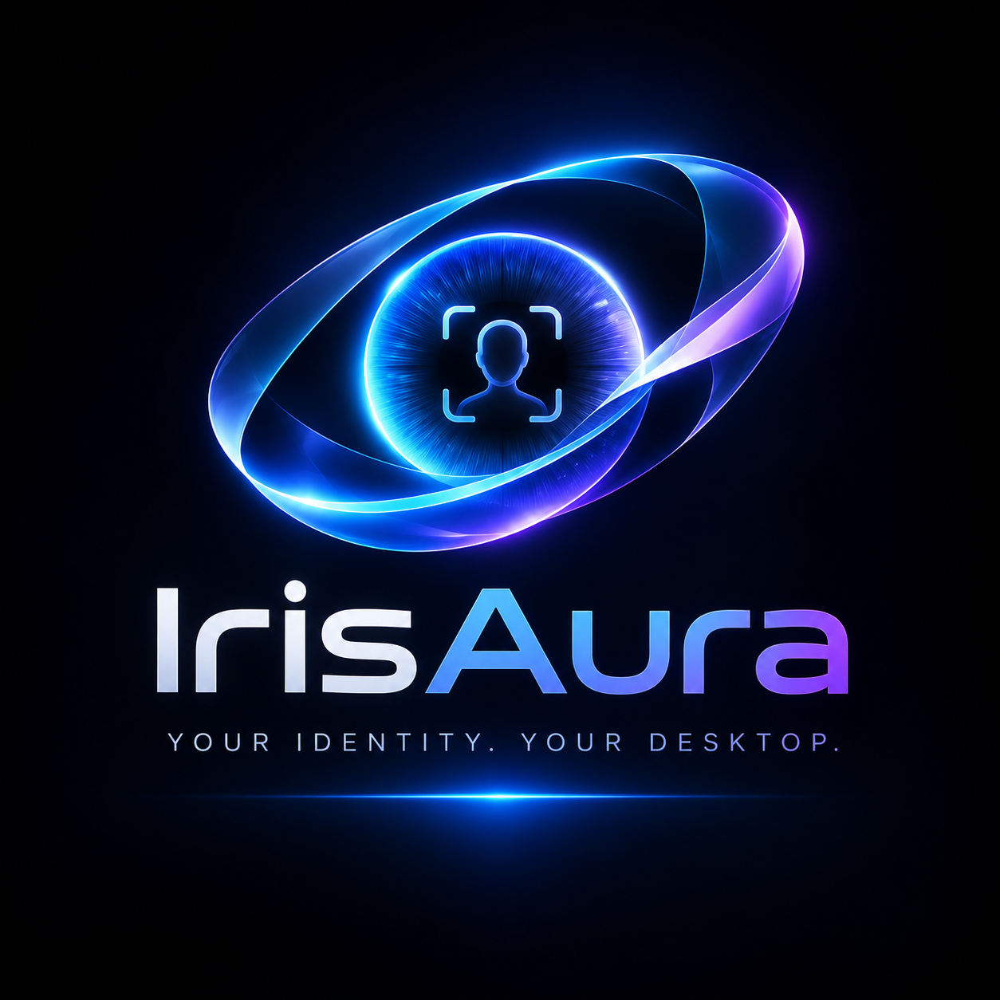
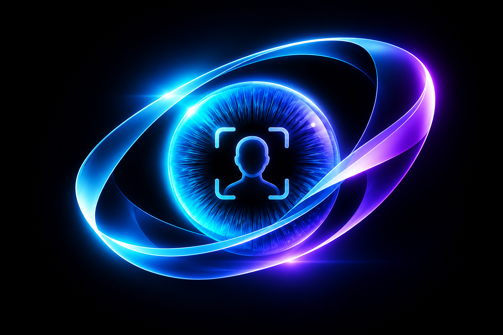
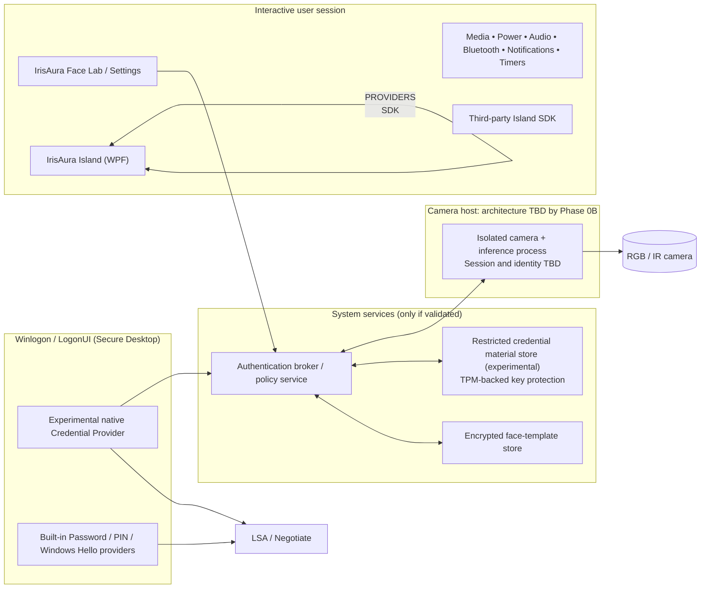
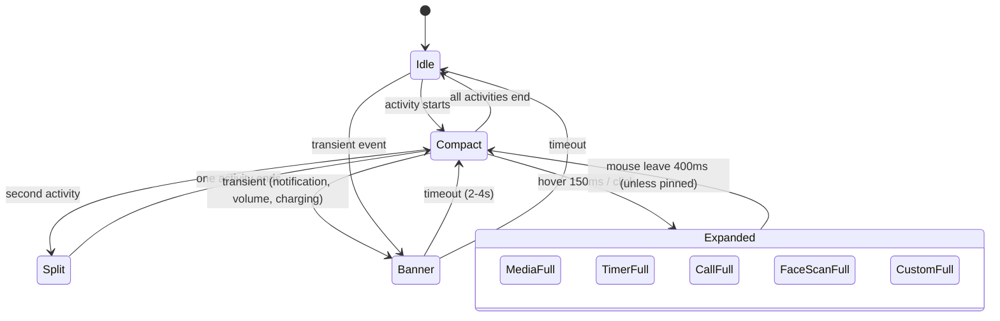

# IrisAura for Windows: Production-Oriented Build Blueprint (V2.1)

<p align="center"></p>

> **What this is:** A risk-controlled, phase-by-phase blueprint for two related Windows products: (1) **IrisAura Island**, a standalone desktop activity interface, and (2) **IrisAura Face**, an experimental face-recognition and Windows sign-in research track. It is written for **Claude Code** to implement one approved phase at a time. It does not promise Apple-equivalent security or guaranteed compatibility with every Windows device.
>
> **Save this file as:** `docs/BLUEPRINT.md` in the repository root. Section 17 contains the `CLAUDE.md` rules and per-phase prompts. This V2 deliberately introduces proof-of-concept gates before any custom credential provider is enabled.
>
> **Revision:** V2.2 — 24 Nov 2026 (consistency and implementation-readiness fixes; see change log item 9). V2.1 named the product **IrisAura** and added the brand section in §0. Items marked **⚠ VERIFY** are unverified assumptions. This document is an engineering plan, not a security certification, legal opinion, or proof that an API works on every supported Windows build.

---

## Table of Contents

0. [Product Identity and Brand](#0-product-identity-and-brand)
1. [Executive Summary and Honest Feasibility](#1-executive-summary-and-honest-feasibility)
2. [iPhone Face ID vs. What Windows Allows](#2-iphone-face-id-vs-what-windows-allows)
3. [Windows Sign-In Architecture (Must Know)](#3-windows-sign-in-architecture-must-know)
4. [Final Tech Stack](#4-final-tech-stack)
5. [System Architecture](#5-system-architecture)
6. [Repository Structure](#6-repository-structure)
7. [IrisAura Face: Module Specifications](#7-irisaura-face-module-specifications)
8. [IrisAura Island desktop activity interface: Full Specification](#8-irisaura-island-desktop-activity-interface-full-specification)
9. [Security, Privacy, Threat Model, Recovery](#9-security-privacy-threat-model-recovery)
10. [Implementation Phases](#10-implementation-phases)
11. [Testing Strategy and Performance Targets](#11-testing-strategy-and-performance-targets)
12. [Packaging, Signing, Updates, Licensing](#12-packaging-signing-updates-licensing)
13. [Model Licensing (Commercial)](#13-model-licensing-commercial)
14. [Risks, Mitigations, Known Limitations](#14-risks-mitigations-known-limitations)
15. [Reference Projects](#15-reference-projects)
16. [Sources](#16-sources)
17. [How to Feed This to Claude Code](#17-how-to-feed-this-to-claude-code)

---

## V2 Change Log and Non-Negotiable Product Decisions

This revision preserves the useful feature planning from V1 but changes the implementation order and tightens the security claims.

1. **Use .NET 10 LTS**, not .NET 9. .NET 9 reached end of support on 10 Nov 2026; .NET 10 LTS is supported through 14 Nov 2028. Keep projects on the latest supported .NET 10 servicing patch. See §16.
2. **Build IrisAura Island independently first.** It must run without the IrisAura Face service, credential provider, or biometric enrollment.
3. **Prove camera access before selecting the final pre-logon architecture.** Session 0 camera access, IR availability, privacy controls, and device ownership are hardware/OS-dependent. Do not assume a LocalSystem service can open every camera.
4. **Treat custom face sign-in as experimental and high risk.** Windows Credential Providers collect and serialize credentials; they are not a supported plug-in point for replacing the Windows Hello biometric engine.
5. **Windows Hello remains the production recommendation.** On supported hardware, guide users to Windows Hello. Do not disable or replace Microsoft's providers.
6. **Do not claim a biometric FAR/APCER/BPCER target until measured** using a defined, sufficiently large, representative and independently reviewed evaluation protocol.
7. **No production release until security, recovery, privacy, licensing, and hardware gates pass.** A successful demo is not production readiness.
8. **V2.1:** the product is named **IrisAura** (§0). "Halo" was dropped because it is a Microsoft trademark. The Island SDK pipe and CLI now belong to IrisAura Island, so the Island can ship without the Face components. Fixed the `DMPPig/WinIsland` reference.
9. **V2.2:** pre-implementation review fixes:
   - Adaptive learning is consistently **excluded from v1** (§2, §7.3 now match §7.7).
   - Code-signing eligibility is no longer hard-coded (§12.4 now follows §1.4); certificate procurement starts in Phase 0A with a dev certificate meanwhile.
   - Logs split by process identity: per-user apps log to `%LocalAppData%`, services to `%ProgramData%` (§0.2, §4).
   - Project layout clarified: new shared WPF library `IrisAura.Theme` (brand tokens + glyphs); the Face Lab app is renamed `IrisAura.Face.Lab` (was `IrisAura.Settings`); the Island owns its own settings window, so Release 1 needs no Face project (§0.2, §6, §8.7).
   - `IrisAura.Contracts` and `IrisAura.Island.Sdk` target `netstandard2.0`; `Directory.Build.props` applies only to SDK-style C# projects (§6).
   - Approved packages extended: `Microsoft.Windows.CsWin32`, `System.CommandLine`, and, for the `netstandard2.0` targets only, `System.Text.Json` and `System.Security.Principal.Windows` (§4). Brand assets use the ImageMagick script, not ImageSharp (§0.6). FluentAssertions licence flagged (v8+ is commercial). NuGet versions pinned centrally in `Directory.Packages.props`.
   - Island SDK messages now carry a protocol version (`"v": 1`), and the SDK verifies the pipe server's identity (§8.6.14).
   - Click-through corrected: `HTTRANSPARENT` only forwards clicks to windows of the **same thread**, so it cannot pass clicks to other apps. Use layered-window alpha + `WS_EX_TRANSPARENT` toggling (§8.3).
   - Global hotkeys no longer use the Windows key (reserved for the OS by `RegisterHotKey` documentation; `Win+Alt+T` clashes with Xbox Game Bar). Keyboard-focus mode defined against `WS_EX_NOACTIVATE` (§8.3, §8.6.10).
   - Top-docked taskbar qualified as Windows 10 / third-party-tool only (§8.3, §8.12).
   - IPC framing made explicit per pipe (§4, §8.6.14).
   - Phase order clarified: after 0A, the Island track (Phases 1–5) and the Face feasibility spikes (0B, 0C) run independently (§10).

### Product release boundaries

| Product/release | Scope | Can ship independently? |
|---|---|---|
| **IrisAura Island** | Desktop activity interface, media, HUDs, timers, notifications, SDK | Yes; first release target |
| **IrisAura Face Lab** | Local enrollment, camera diagnostics, detection, embeddings, liveness experiments | Yes; research/utility build, not an authentication factor |
| **IrisAura Face Sign-in** | Experimental native Credential Provider integration | No commercial release until all §3, §7, §9 and §10 gates pass; Windows Hello is preferred |

### Engineering decision rule

If an API, model, driver, Windows build, camera, or security behaviour is not proven, implement a small isolated proof of concept and record the result in `docs/DECISIONS/` and `docs/HARDWARE_MATRIX.md`. Do not let Claude Code silently convert an assumption into a production design.

## 0. Product Identity and Brand

<p align="center">
  
  &nbsp;&nbsp;
  
</p>

### 0.1 Name and tagline

| Item | Value |
|---|---|
| Product (umbrella brand) | **IrisAura** |
| Tagline | **Your identity. Your desktop.** |
| Desktop activity interface (first release) | **IrisAura Island** |
| Face-recognition research build | **IrisAura Face Lab** |
| Experimental Windows sign-in track | **IrisAura Face Sign-in** |
| Short UI names | "Island", "Face Lab" (inside the app only) |

**Spelling rule:** always one word, capital **I** and capital **A**: `IrisAura`. Never "Iris Aura", "Irisaura" or "IRISAURA" in UI text. (The all-caps wordmark style lives only in the logo image.)

### 0.2 Technical identifiers (use exactly these)

| Thing | Identifier |
|---|---|
| Solution / root namespace | `IrisAura` (`IrisAura.sln`) |
| Island projects | `IrisAura.Island`, `IrisAura.Island.Providers`, `IrisAura.Island.Sdk`, `IrisAura.Island.Cli` |
| Face projects | `IrisAura.Face.Lab` (WPF app), `IrisAura.Face.Camera`, `.Vision`, `.Core`, `.Security`, `.Service`, `.CredentialProvider` |
| Shared projects | `IrisAura.Contracts` (netstandard2.0 DTOs), `IrisAura.Theme` (WPF brand tokens + glyphs), `IrisAura.Tools` |
| Install folder | `%ProgramFiles%\IrisAura\` |
| Machine data / logs | `%ProgramData%\IrisAura\` (logs in `\logs`), for LocalSystem services and installer custom actions only |
| Per-user data / logs | `%LocalAppData%\IrisAura\` (Island timers, shelf, settings; logs in `\logs` for the Island, CLI and Face Lab) |
| Island SDK pipe | `\\.\pipe\IrisAura.Island.Activities.<UserSID>` |
| Face pipes (conditional track) | `\\.\pipe\IrisAura.Face.Auth`, `\\.\pipe\IrisAura.Face.Admin`, `\\.\pipe\IrisAura.Face.Events` |
| Sparse package identity name | `IrisAura.Island` (Publisher = the exact subject of your code-signing certificate) |
| Island executable | `IrisAura.Island.exe`; CLI `irisaura-island.exe` |
| Scheduled task | `\IrisAura\IrisAura Island (logon)` |
| Event Log source | `IrisAura` |
| HKCU settings key (if needed) | `HKCU\Software\IrisAura` |

### 0.3 Logo files

| File (repo path) | Source | Use for |
|---|---|---|
| `assets/brand/irisaura-logo.png` | Symbol only, 1536×1024, black background | Splash, About page, installer dialog art, large icon (256 px) source |
| `assets/brand/irisaura-wordmark.png` | Symbol + "IrisAura" + tagline, 1254×1254, black background | README, website, Settings → About, client documents |

- Both logos sit on **pure black**. They are designed for dark surfaces only. Do not place them on white or light-grey backgrounds. If a light-background version is ever needed, have it designed separately; don't invert or recolour the PNGs in code.
- Keep the originals untouched. Generated sizes go in `assets/brand/generated/` and are re-created by script (§0.6).
- **⚠ VERIFY:** obtain or export a **vector (SVG)** master of the symbol from the designer before release. The PNGs are fine for development, but icons and high-DPI art are much sharper when generated from vector.

### 0.4 Colour palette (sampled from the logos)

| Token | Hex | Where it appears in the logo | Use in the app |
|---|---|---|---|
| `Aura.Void` | `#000000` | Background | Island pill, splash background |
| `Aura.Surface` | `#0B0D1A` | — (derived) | Settings window background, cards |
| `Aura.Frost` | `#E2E6F4` | "Iris" lettering | Primary text on dark |
| `Aura.Mist` | `#A8C4F0` | Tagline | Secondary text, captions |
| `Aura.Cyan` | `#22C3F2` | Bright ring highlights | Success state, focus rings, scan sweep |
| `Aura.Blue` | `#4A92F2` | "A" lettering, iris | Primary accent, buttons, progress bars |
| `Aura.Indigo` | `#1A30A8` | Deep iris / ring shadow | Pressed states, gradient middle |
| `Aura.Violet` | `#8A3FF2` | "ura" lettering, ring tail | Secondary accent, gradient end |
| `Aura.Error` | `#FF4D5E` | — (not in logo) | Failure shake, errors (keep it out of branding) |

**Signature gradient ("Aura ring"):** `Aura.Cyan → Aura.Blue → Aura.Violet`, at 135°. Use it sparingly: the Face scan ring, the Settings header line, primary-button hover glow. Never use it for body text.

The Island keeps its **black pill** (`Aura.Void`). The brand appears in the Island only as the thin animated **Aura ring** during Face events and as the accent colour when an activity has no album-art tint.

Put these tokens in one shared resource dictionary, `IrisAura.Theme/Themes/Brand.xaml`, as `Color` and `SolidColorBrush` resources with the token names above. `IrisAura.Island` and `IrisAura.Face.Lab` both reference `IrisAura.Theme` and merge it in `App.xaml`, so the tokens exist exactly once and the Island never depends on a Face project. No hard-coded hex values in views.

### 0.5 Typography and glyphs

- **UI font:** `Segoe UI Variable` (Windows 11) with fallback `Segoe UI`. It's built into Windows, so it's free to use and sharp at every DPI.
- **Wordmark:** use the image only. Don't try to recreate the logo lettering with a font in XAML.
- **Face scan glyph (Island + Face Lab):** draw an original vector version of the logo's *person-in-corner-brackets* mark as a XAML `Path` (`IrisAura.Theme/Assets/Glyphs.xaml`, shared by the Island and Face Lab). It ties the Island to the brand.
  - **Scan:** the brackets pulse while an Aura-ring arc sweeps around them.
  - **Success:** the person shape cross-fades into a checkmark in `Aura.Cyan`.
  - **Failure:** a horizontal shake with a brief `Aura.Error` tint.
  - This person-in-brackets mark is a generic face-recognition symbol and differs from Apple's Face ID glyph. Keep it that way: no smiley face, no Apple-style rounded "face" lines.

### 0.6 Required generated assets

The detailed symbol (glowing ribbons, iris texture) is unreadable below about 48 px. So create a **simplified icon mark** for small sizes: the iris circle in the Aura gradient + the bracket-person in `Aura.Frost`, no ribbons, no glow. Until a designer supplies it, Claude Code may draft it as an SVG for review. **It must be approved by you before release.**

| Asset | Sizes | Source | Used by |
|---|---|---|---|
| App icon `.ico` | 16, 20, 24, 32, 40, 48 (simplified mark); 64, 256 (full symbol, cropped square) | simplified mark + logo | EXEs, shortcuts, Add/Remove Programs (`ARPPRODUCTICON`) |
| Tray icon `.ico` | 16, 20, 24, 32 | white bracket-person only (monochrome) | Island tray icon (Windows tray icons should be simple and monochrome) |
| Sparse package logos | `Square44x44Logo` (+ `targetsize-16/24/32/48/256`), `Square150x150Logo`, `StoreLogo` 50×50 | simplified mark | `packaging/IslandIdentity/AppxManifest.xml` (identity packages still need these) |
| WiX banner | 493×58 BMP | wordmark (text only, left-aligned) on `Aura.Void` | `WixUIBannerBmp` |
| WiX dialog | 493×312 BMP | symbol on the left 164 px, black | `WixUIDialogBmp` |
| Splash / About art | 512×512 PNG (+ @2x) | symbol | Settings → About, Face Lab welcome screen |
| README header | 1280×640 PNG | wordmark | GitHub/README, client documents |

**Generation:** `scripts/build-brand-assets.ps1`, using ImageMagick 7 (`magick`) installed on the developer machine as a build-time tool only (nothing is redistributed). Do not use SixLabors.ImageSharp: its split licence can require a paid commercial licence, and the script needs no NuGet package. The script reads `assets/brand/*`, writes `assets/brand/generated/*`, and is re-runnable. Check generated icons at 100 %, 150 % and 200 % scaling on a real display.

### 0.7 Brand and naming rules

- **"Iris" is a name, not a feature claim.** IrisAura recognises **faces**, not irises. Never write "iris scan", "iris recognition" or "eye scan" in the UI, installer, website or client documents. Say "face recognition".
- **No Apple names in product UI:** no "Face ID", "Dynamic Island", "Live Activities" (use "activities"), "AirDrop", SF Symbols or Apple sounds. (§8.13.)
- **Trademark check before launch ⚠ VERIFY:**
  - Search "IrisAura" (and similar names) on the Indian trademark register (ipindia.gov.in), class 9 (software).
  - Do the same in any country where the client will use it.
  - Check the domain and the Microsoft Store name.
  - Consider registering the mark yourself before selling to the client.
- **Ownership:** if the logos were made with an AI image tool or by a designer, record who made them and under what terms in `docs/BRAND_LICENSE.md`. You need clear rights before selling the product to a client.

---

## 1. Executive Summary and Honest Feasibility

**The honest verdict:** IrisAura Island is feasible as a standalone Windows desktop application. A custom face-recognition sign-in flow is a separate, high-risk research project. A native **C++ Credential Provider** can participate in Windows credential collection, but Windows does not provide third parties with a supported way to replace the Windows Hello face-matching pipeline. A custom provider still needs a valid Windows credential to serialize. The camera/service architecture is **not selected** until the pre-logon camera proof of concept in Phase 0B passes.

### 1.1 What can match iPhone Face ID

- **Potential hands-free experience:** technically prototype-able on a narrowly validated hardware/OS matrix; not a promised universal Windows feature.
- **Attention check:** eyes open and looking at the screen.
- **Alternate appearance:** a second face look, such as with glasses.
- **Adaptive templates:** experimental only; disabled by default until poisoning resistance and biometric evaluation are independently reviewed.
- **Latency:** measure end-to-end latency on a declared hardware matrix. Do not promise sub-second unlock before real measurements.
- **Animation:** a Face ID-like scan animation inside your own apps and in the Island.

### 1.2 What cannot match iPhone Face ID

| Limitation | Why |
|---|---|
| No 3D depth map | Apple's TrueDepth camera projects a dot pattern to measure depth. Almost no Windows laptop has this hardware. |
| No hardware-isolated matching for your code | Apple matches inside the Secure Enclave. On Windows, only Microsoft's own Windows Hello face pipeline gets that kind of isolation (Enhanced Sign-in Security, ESS). |
| No custom animation on the lock screen | The lock screen runs on a protected "Secure Desktop". A credential provider can show only a tile image, text, links and buttons. |
| No Apple-grade false-accept claim | Apple publishes a rate below 1 in 1,000,000. A normal webcam pipeline cannot honestly claim that. |

### 1.3 Security tiers

The app must detect available hardware/capabilities and show an honest capability label. Do not equate camera presence with a certified security tier.

| Tier | Hardware | Method | Honest security level | Default policy |
|---|---|---|---|---|
| **T1 Native** | Windows Hello IR camera (with or without ESS) | Detect Windows Hello and guide the user to enroll Hello Face. Your app adds the Island experience and app-lock through `UserConsentVerifier`. | Highest available on Windows | **Recommended.** Your own credential provider is disabled for this user. |
| **T2 Custom IR** | IR stream that the app can demonstrably read | Experimental IR + RGB presentation-attack checks and RGB identity matching | Unknown until tested; not certified | Lab only; never label as secure or certified |
| **T3 RGB** | Ordinary webcam | RGB matching and experimental passive presentation-attack detection | Low assurance; replay and synthetic attacks may succeed | Lab/demo only; no Windows sign-in release |

> **Client rule:** T3 is a lab/demo convenience feature only. Do not position RGB-only face matching as an authentication factor, MFA, compliance control, or protection against a motivated attacker. T2 is also experimental and is not certified merely because an IR stream is present. For production Windows sign-in, use Windows Hello on supported hardware.

### 1.4 Commercial blockers to plan for

- **Model licences:** InsightFace pretrained weights (`buffalo_l`, `antelopev2`) are for non-commercial use only. Ship **YuNet (MIT)**, **SFace (Apache-2.0)** and **MiniFASNet (Apache-2.0)** instead, or buy an InsightFace licence.
- **Code signing:** verify current provider eligibility, validation rules, and pricing at procurement time. Do not hard-code country eligibility claims into the product plan. Budget for a reputable Authenticode signing route and timestamping.
- **Installer:** use **WiX/MSI**, not MSIX, for the provider and service.
- **Trademarks:** do not use Apple's product names, logos, glyphs, sounds, or copied visual assets in the product UI. See §8.13.
- **Privacy law:** obtain current legal advice for India DPDP, GDPR, employment monitoring, biometric processing, and cross-border deployments before collecting any biometric data. Effective dates and obligations must be rechecked at release.

---

## 2. iPhone Face ID vs. What Windows Allows

| Face ID element | How Apple does it | Windows equivalent | Achievable? |
|---|---|---|---|
| Depth sensing | Dot projector + IR camera → depth map | Rare depth cameras; IR only on Hello laptops | No on RGB; partial on T2 |
| Flood illuminator | IR flood light for darkness | IR emitters on Hello cameras | T1/T2 only |
| Secure matching | Secure Enclave; face images discarded after encoding | ESS runs Microsoft's face algorithm in VBS; third parties are excluded | T1 only (through Hello) |
| False-accept rate | Apple publishes its own Face ID security figures under its threat model | Must be measured under a defined independent protocol; no target is promised by this blueprint | Not comparable without equivalent methodology |
| Attempt limit | 5 failures → passcode required | Your lockout policy | Yes |
| Attention awareness | Gaze + eyes open | Eye-openness + head-pose checks | Yes (approximate) |
| Adaptive learning | Updates template after matches | Rolling template gallery with quality gates is technically possible, but template poisoning is a real risk | **Not in v1**; research only after independent review (§7.7) |
| UX animation | Face glyph → checkmark | Static credential tile, then IrisAura Island animation once the desktop appears | Partial |

### 2.1 Windows Hello hardware facts you need

- **Minimum stream sizes:** RGB 480×480 at 7.5 fps; IR 340×340 at 15 fps (Microsoft UVC guide).
- **April 2025 change:** since the April 8, 2025 update (KB5055523, CVE-2025-26644), Windows Hello face needs a visible face in **both RGB and IR**. As a result, it no longer works in complete darkness.
- **Camera-spoofing history:** in CVE-2021-34466, researchers used a fake USB "camera" to replay IR frames. Microsoft responded by trusting only the camera used at enrollment.
- **Design rule for your app:** record the camera's identity at enrollment. Treat any new or virtual camera as untrusted.

---

## 3. Windows Sign-In Architecture (Must Know)

### 3.1 Credential Provider framework

- **Loading:** LogonUI.exe loads every registered credential provider through `CoCreateInstance`.
- **Registration:** a COM CLSID, plus a key under:
  `HKLM\SOFTWARE\Microsoft\Windows\CurrentVersion\Authentication\Credential Providers\{CLSID}`
- **Interfaces to implement:**
  - `ICredentialProvider`
  - `ICredentialProviderSetUserArray` (V2 per-user tiles)
  - `ICredentialProviderCredential2` (exposes `GetUserSid`)
  - Optionally `ICredentialProviderCredentialWithFieldOptions`
- **Usage scenarios:**
  - `CPUS_LOGON` and `CPUS_UNLOCK_WORKSTATION`. Since Windows 10 these are combined; build the right structure for whichever scenario you receive.
  - `CPUS_CREDUI` (UAC and remote prompts): **not supported in v1**.
  - `CPUS_CHANGE_PASSWORD`: return `E_NOTIMPL`.
- **Building the logon request (serialization):**
  - Pack a `KERB_INTERACTIVE_UNLOCK_LOGON`.
  - Set `MessageType` to `KerbInteractiveLogon` for sign-in and `KerbWorkstationUnlockLogon` for unlock.
  - Get the package ID from `LsaLookupAuthenticationPackage("Negotiate")`.
  - Copy `KerbInteractiveUnlockLogonInit/Pack` and `ProtectIfNecessaryAndCopyPassword` from Microsoft's `Windows-classic-samples/Samples/CredentialProvider/cpp/helpers.cpp`.
  - **Known bug to avoid:** an open-source face-login project recognised the face correctly, but Windows still rejected the unlock (error `0xC000006D` / `0xC00000E5`). The fix was to use `KerbWorkstationUnlockLogon` for unlock and keep the domain and username fields separate.
- **Auto-submit flow (how it "opens automatically"):**
  1. LogonUI calls `Advise(ICredentialProviderEvents*)` on the provider.
  2. When the service reports a match, the provider calls `CredentialsChanged`.
  3. `GetCredentialCount` returns the face tile as the default, with `*pbAutoLogonWithDefault = TRUE`.
  4. LogonUI calls `GetSerialization` and signs the user in.
  5. `ReportResult` tells you whether it worked. If it failed (for example, the password changed), disable auto-logon and ask the user to re-enter their password.
- **What the tile can show:** a bitmap (`CPFT_TILE_IMAGE`), large and small text, a command link and a submit button. Update the status text with `ICredentialProviderCredentialEvents::SetFieldString`, for example "Looking for you…", "Face not recognized", "Locked — use PIN".
- **Windows 11 gotchas:**
  - Build **x64 and ARM64** natively. ARM64 LogonUI silently skips an x64 DLL.
  - Do not register under "Credential Provider Filters".
  - Sign the DLL with Authenticode.
  - Never build an LSA plug-in (SSP/AP) or a password filter for this product.

### 3.2 Why the provider must be native C++

Microsoft documents Credential Providers as native COM components; keep the provider native C++. Do not load the .NET runtime or camera/ML dependencies into LogonUI. Lithnet's .NET credential-provider library exists (MIT licence, one maintainer), but it loads the .NET runtime into LogonUI. pGina has been unmaintained since 2018.

**Provisional decision:** if Phase 0C proves the sign-in path is viable, build a minimal native C++ provider from Microsoft’s sample. Keep it small and fail-closed. Do not commit to the proposed line count. The recognition host and camera topology remain undecided until the pre-logon proof of concept is complete.

### 3.3 Why not plug into Windows Hello directly

Windows Biometric Framework adapters come from camera manufacturers (OEMs). Third-party biometric service providers are not supported. With ESS turned on, only ESS-capable sensors work at all.

**T1 strategy:**
1. Detect Windows Hello with `UserConsentVerifier.CheckAvailabilityAsync()` and `KeyCredentialManager.IsSupportedAsync()`.
2. Detect ESS from Event Log ID 1108, or from Windows Security → Device Security.
3. Recommend Hello Face to the user and disable your own provider for that user.

### 3.4 Detecting IR vs. RGB cameras

- Call `MediaFrameSourceGroup.FindAllAsync()` and look in `SourceInfos` for `MediaFrameSourceKind.Infrared` or `Depth` paired with a `Color` source in the same group.
- Record for each camera:
  - `DeviceInformation.Id`
  - USB VID/PID (from the symbolic link)
  - `EnclosureLocation.Panel` (Front means a built-in camera)
- Flag virtual cameras (OBS, Logi Tune, etc.) as **untrusted**.
- **⚠ VERIFY:** whether an app can read the IR stream while Windows Hello owns it, or on ESS devices at all. If it can't, the laptop is T1 (use Hello) or falls back to T3.

### 3.5 Triggers: lid open, wake, lock

- **Provider trigger (conditional):** when the lock screen appears, the provider may request `BeginScan(sessionId, scenario)` over the pipe. The broker must not assume it can open the camera; that capability is determined only by Phase 0B.
- **Service hints for pre-warming:**
  - `SERVICE_CONTROL_SESSIONCHANGE` (lock, unlock, logon)
  - `SERVICE_CONTROL_POWEREVENT`
  - `RegisterPowerSettingNotification` for `GUID_LIDSWITCH_STATE_CHANGE` and `GUID_CONSOLE_DISPLAY_STATE`
  - On Modern Standby laptops, display-on is the reliable trigger.
- **Scan budget:** 5–8 seconds, then turn the camera off (LED off) and wait for a key press or tile click to retry. This matches iPhone's "swipe up to retry".
- **Never** unlock by injecting keystrokes from a service. The credential provider is the only supported path.

### 3.6 Mandatory pre-logon camera proof of concept (Phase 0B)

This is a **go/no-go experiment**, not an implementation detail. A Windows service running in Session 0 and LogonUI on the secure desktop are not the same thing as a normal interactive desktop application. Camera privacy settings, driver behaviour, camera exclusivity, session isolation, and ESS can change the result.

Test each candidate camera on each target Windows build using a tiny throwaway diagnostic program. Record:

- Whether enumeration works as LocalSystem in Session 0.
- Whether RGB frames can be opened before user logon and while the workstation is locked.
- Whether IR/Depth streams are visible and readable.
- Whether the camera is already owned by Windows Hello or another process.
- Whether Windows privacy controls or enterprise policy deny access.
- Whether the camera LED/indicator behaves correctly and predictably.
- Whether suspend/resume, lid close/open, fast user switching, RDP, and camera disconnect/reconnect are handled safely.
- Whether the same result holds on x64 and ARM64 devices.

**Pass condition:** documented, repeatable frame capture on every device class explicitly included in the product support matrix, without bypassing Windows security/privacy controls. A single successful laptop is not universal proof.

**Fail condition:** if the pre-logon camera path is unavailable or unreliable, do not work around it with keystroke injection, hidden desktop sessions, driver hacks, undocumented APIs, or weakening system security. Keep IrisAura Face Lab as an in-session demo and use Windows Hello for Windows sign-in.

### 3.7 Credential Provider boundary

A Credential Provider is a credential-collection and serialization component. It is not a supported third-party Windows Hello biometric plug-in. A face match does not automatically authenticate a Windows account. The provider must still serialize credentials acceptable to the configured authentication package and account type.

Before any implementation beyond a mock tile, produce a written design for local accounts, Microsoft accounts, Entra ID/domain accounts, password changes, passwordless accounts, cached domain logon, account lockout, and remote sign-in. If the design requires retaining a reusable Windows password, classify it as a high-risk credential-vault product and require independent security review. If the risks cannot be accepted, stop the custom sign-in track.

---

## 4. Final Tech Stack

| Layer | Choice | Why | Rejected alternatives |
|---|---|---|---|
| Credential provider | **Conditional C++20 COM DLL, MSVC, x64 + ARM64** | Native COM is the documented Credential Provider model; implementation remains experimental | Managed provider inside LogonUI; LSA plug-ins/password filters |
| Face engine host | **C# .NET 10 worker/process, topology TBD by Phase 0B** | Keeps ML outside LogonUI; deployment model must be proven | Assuming Session 0 can always access camera hardware |
| Camera | **MediaFrameReader proof of concept first**; OpenCvSharp only after device/API validation | Candidate API for frame sources and device IDs | Selecting a production camera host before testing Session 0, privacy, IR and lock-screen behaviour |
| Inference | **Microsoft.ML.OnnxRuntime** (CPU by default; DirectML optional; Windows ML for NPUs on 24H2+) | Small models run in milliseconds on CPU | ML.NET; dlib |
| Image operations | **OpenCvSharp4** (Apache-2.0) | Face alignment (affine warp), contrast correction (CLAHE) | SkiaSharp |
| Face detection | **YuNet** (MIT) | Fast; returns 5 facial landmarks | SCRFD/RetinaFace (weights non-commercial) |
| Face recognition | **SFace** (Apache-2.0, 128-dimension embedding) | Safe for commercial use | ArcFace `buffalo_l` (non-commercial) |
| Liveness, RGB | **MiniFASNetV2 + V1SE** (Apache-2.0, ONNX) | The only mature open liveness weights | Commercial iBeta-certified SDKs, if the client needs certification |
| Attention | MediaPipe Face Landmarker (Apache-2.0) or YuNet landmarks + eye-openness check | Eyes-open and gaze checks | — |
| IPC | **Named pipes**, strict access-control lists. Face pipes (C++ ↔ C#): 4-byte little-endian length prefix + UTF-8 JSON. Island SDK pipe: newline-delimited UTF-8 JSON so scripts can use it (§8.6.14). | Easy from both C++ and C# | RPC/ALPC (more complex); TCP (larger attack surface) |
| Secret storage | TPM-backed CNG for device-bound keys; DPAPI only for explicitly scoped fallback data | Protects keys at rest when correctly configured | Treating TPM encryption as protection against a compromised SYSTEM service or a malicious administrator |
| Face Lab app (`IrisAura.Face.Lab`) | **WPF .NET 10**, shares `IrisAura.Theme` with the Island | Fast to build; consistent with IrisAura Island | Electron/Angular (heavy) |
| **IrisAura Island** | **WPF .NET 10**, transparent topmost window, Windows Runtime APIs (media, power, devices, notifications), NAudio for audio levels | Suitable for a lightweight Windows shell | WinUI 3 (evaluate if WPF limitations block a required feature) |
| IrisAura Island identity | **Sparse package** (package identity with external location), registered by the MSI | Required for the notification listener | Full MSIX |
| Installer | **WiX Toolset MSI** + Burn bundle | Handles COM, service and HKLM registration | MSIX (registry virtualisation breaks LogonUI COM registration) |
| Signing | Authenticode signing through an eligible, reputable certificate or signing service + RFC 3161 timestamp | Choose after verifying current provider eligibility, identity validation, hardware-key and distribution requirements | — |
| Logging | Serilog → `%LocalAppData%\IrisAura\logs` for per-user processes (Island, CLI, Face Lab) and `%ProgramData%\IrisAura\logs` for LocalSystem services only; ETW EventSource; TraceLogging in C++ | Each process writes where its identity has access, without loosening ProgramData ACLs | — |

**NuGet packages (approved list):**
- `Microsoft.ML.OnnxRuntime`
- `OpenCvSharp4`, `OpenCvSharp4.runtime.win`
- `Serilog`, `Serilog.Sinks.File`
- `Microsoft.Extensions.Hosting.WindowsServices`
- `NAudio` (CoreAudio volume and peak meters; WASAPI loopback)
- `CommunityToolkit.Mvvm`
- `System.Management` (WMI brightness events)
- `xunit`, `FluentAssertions`, `NSubstitute`
- `Microsoft.Windows.CsWin32` (MIT; build-time source generator for Win32 P/Invoke such as `SetWinEventHook`, `SHQueryUserNotificationState`, `RegisterHotKey`; private asset, nothing redistributed)
- `System.CommandLine` (MIT; argument parsing for `irisaura-island.exe` and `IrisAura.Tools`; pin a stable 2.x release ⚠ VERIFY current stable version)
- **`netstandard2.0` targets only** (`IrisAura.Contracts`, `IrisAura.Island.Sdk`): `System.Text.Json` (JSON is not built into netstandard2.0) and `System.Security.Principal.Windows` (current user SID for the SDK pipe name). .NET 10 projects use the in-box versions and must not reference these packages.

**FluentAssertions licence ⚠ VERIFY:** versions 8+ use a commercial licence for commercial use; pin 7.x (Apache-2.0) or buy a licence. Tests are not redistributed, but the licence still applies to commercial development.

Anything else needs approval.

---

## 5. System Architecture



### 5.1 Unlock sequence

1. The provider connects to a narrowly ACL-restricted broker using a versioned, authenticated IPC contract. Peer PID/path checks alone are not sufficient authentication.
2. The provider requests a scan for the current usage scenario and candidate user SID.
3. **Only if Phase 0B proves pre-logon camera access:** the broker coordinates an isolated camera host. Otherwise custom sign-in is blocked and the built-in Windows providers remain available.
4. A successful match is not itself a Windows credential. The experimental flow would still need to obtain and serialize a valid credential; see the critical warning in §7.8.
5. The provider serializes only after policy, liveness, lockout, user/SID binding, and credential-state checks pass. Any timeout, malformed IPC, service failure, or uncertainty returns to the built-in sign-in methods.
6. After the desktop appears, IrisAura Island may show a local success activity. This animation is informational only and is not part of authentication.

---

## 6. Repository Structure

```
IrisAura/
├─ IrisAura.sln
├─ CLAUDE.md                              # rules for Claude Code (see §17)
├─ Directory.Build.props                  # C# defaults (see note below); C++ projects use their own .props
├─ Directory.Packages.props               # central package management: every NuGet version pinned here
├─ native/
│  └─ IrisAura.Face.CredentialProvider/   # C++ vcxproj (x64, ARM64)
│     ├─ dllmain.cpp, guid.h, ClassFactory.cpp
│     ├─ Provider.cpp/.h                  # ICredentialProvider, ICredentialProviderSetUserArray
│     ├─ Credential.cpp/.h                # ICredentialProviderCredential2
│     ├─ PipeClient.cpp/.h                # overlapped I/O, timeouts, server verification
│     ├─ Serialization.cpp/.h             # KERB_INTERACTIVE_UNLOCK_LOGON (from MS helpers.cpp)
│     ├─ Fields.h
│     └─ resources/tile.bmp
├─ src/
│  ├─ IrisAura.Contracts/                 # netstandard2.0; versioned pipe DTOs (lab, admin, events, IrisAura Island activities)
│  ├─ IrisAura.Theme/                     # WPF class library: Themes/Brand.xaml (§0.4), Assets/Glyphs.xaml (§0.5)
│  ├─ IrisAura.Face.Lab/                  # WPF IrisAura Face Lab app: enrollment, diagnostics, Face settings
│  ├─ IrisAura.Face.Core/                 # lab matching, evaluation, policies
│  ├─ IrisAura.Face.Vision/               # ONNX: YuNet, SFace, MiniFASNet, landmarks
│  ├─ IrisAura.Face.Camera/               # ICameraSource, IR/RGB discovery
│  ├─ IrisAura.Face.Security/             # template protection, pipe ACLs, signature checks
│  ├─ IrisAura.Face.Service/              # optional broker; only after architecture gate
│  ├─ IrisAura.Island/                    # standalone WPF IrisAura Island shell (window, animation, views)
│  │  ├─ Shell/                           # IslandWindow, ClickThrough, Placement, FullscreenDetector, Hotkeys
│  │  ├─ Motion/                          # Spring, SpringVector, MorphController
│  │  ├─ Engine/                          # ActivityManager, PriorityArbiter, ActivityQueue
│  │  ├─ Views/                           # Minimal/Compact/Expanded templates per activity
│  │  ├─ Settings/                        # the Island's own settings window (§8.7); no Face dependency
│  │  └─ Assets/                          # Island-only images; shared glyphs live in IrisAura.Theme
│  ├─ IrisAura.Island.Providers/          # one class per activity source
│  │  ├─ MediaProvider.cs                 # GSMTC
│  │  ├─ AudioLevelProvider.cs            # WASAPI loopback / session meters (waveform)
│  │  ├─ VolumeProvider.cs                # CoreAudio endpoint volume
│  │  ├─ BrightnessProvider.cs            # WMI WmiMonitorBrightnessEvent
│  │  ├─ PowerProvider.cs                 # charging / low battery
│  │  ├─ BluetoothProvider.cs             # device connect/disconnect (+battery ⚠)
│  │  ├─ NotificationProvider.cs          # UserNotificationListener (needs identity)
│  │  ├─ PrivacyIndicatorProvider.cs      # mic/camera in use (ConsentStore)
│  │  ├─ CallProvider.cs                  # heuristic: call app + mic in use + notification
│  │  ├─ TimerProvider.cs                 # own timers/stopwatch
│  │  ├─ DownloadProvider.cs              # Downloads folder watcher (limited)
│  │  ├─ FaceEventsProvider.cs            # optional: loads only if IrisAura Face is installed
│  │  └─ ExternalActivityProvider.cs      # IrisAura Island Activity SDK pipe server
│  ├─ IrisAura.Island.Sdk/                # netstandard2.0 NuGet client library for other apps
│  ├─ IrisAura.Island.Cli/                # `irisaura-island push` for scripts (net10.0-windows)
│  └─ IrisAura.Tools/                     # CLI: cameras, detect, bench, spoof-eval; cp-disable only in conditional track
├─ packaging/IslandIdentity/              # sparse package AppxManifest.xml (identity only)
├─ models/                                # .onnx + LICENSES/ + SHA256SUMS
├─ installer/
│  ├─ IrisAura.Msi/ (WiX)
│  └─ IrisAura.Bundle/ (Burn)
├─ tests/
│  ├─ IrisAura.Face.Core.Tests/  IrisAura.Face.Vision.Tests/  IrisAura.Face.Security.Tests/
│  ├─ IrisAura.Island.Tests/              # arbiter, springs, timeline interpolation
│  └─ datasets/ (gitignored)
├─ assets/brand/                          # irisaura-logo.png, irisaura-wordmark.png, generated icons (§0.6)
├─ docs/ BLUEPRINT.md THREAT_MODEL.md RECOVERY.md PRIVACY.md HARDWARE_MATRIX.md ISLAND_SDK.md DECISIONS/
└─ scripts/ build-brand-assets.ps1 new-dev-cert.ps1 vm-deploy.ps1 cp-register.ps1 cp-disable.ps1 collect-logs.ps1
```

**Build configuration rules:**
- `Directory.Build.props` is also imported by `.vcxproj` files, so wrap its C# settings in `Condition="'$(MSBuildProjectExtension)' == '.csproj'"`. C++ settings (C++20, `/W4`, warnings as errors, x64 + ARM64) go in `native/Directory.Build.props`.
- C# defaults: `TargetFramework` `net10.0-windows10.0.19041.0`, `LangVersion` 14, `Nullable` enable, `TreatWarningsAsErrors` true.
- `IrisAura.Contracts` and `IrisAura.Island.Sdk` override `TargetFramework` to `netstandard2.0`, so .NET Framework apps can use the SDK. They contain no Windows Runtime or WPF code. Keep their language features compatible with netstandard2.0 (no default interface members; `init`/`required` need polyfill attributes defined in the project).
- **Release 1 dependency rule:** `IrisAura.Island*` projects may reference only `IrisAura.Contracts` and `IrisAura.Theme`, never an `IrisAura.Face.*` project. `FaceEventsProvider` talks to the Face Events pipe through `IrisAura.Contracts` DTOs and stays dormant if the pipe does not exist. Add a build/test check that enforces this rule.

---

## 7. IrisAura Face: Module Specifications

### 7.1 Camera (`IrisAura.Face.Camera`)

- **Discovery:** `ICameraDiscovery.Enumerate()` returns `CameraInfo{Id, Name, Kinds[Color|Infrared|Depth], IsBuiltIn, IsVirtual, VidPid, MaxIrFormat}`.
- **Streaming:** `ICameraSource.StartAsync(kinds, ct)` returns `IAsyncEnumerable<FramePair{Rgb?, Ir?, Timestamp}>`.
  - Use `MediaFrameReaderAcquisitionMode.Realtime`.
  - If exclusive access fails, retry in `SharedReadOnly` mode.
- **Tier decision:**
  - Windows Hello available → **T1**
  - Readable IR + RGB in the same source group → **T2**
  - RGB only → **T3**
  - Persist the decision and re-check whenever the hardware changes.
- **Camera pinning:** store the camera ID and VID/PID at enrollment. At unlock, refuse unknown or virtual cameras and fall back to password.
- **Exposure:**
  - Wait about 3 frames for auto-exposure to settle.
  - On IR cameras, drop unlit frames, because the emitters strobe.

### 7.2 Detection and alignment

- **Detection:** YuNet at 320×240 input, score ≥ 0.8, NMS 0.3.
  - Use the largest face.
  - Reject the frame if there are two faces of similar size (protects against shoulder-surfers).
- **Quality gates:**
  - Face width ≥ 112 px
  - Yaw and pitch within ±25°
  - Sharpness (Laplacian variance) above threshold
  - Exposure within range
- **Alignment:** a 5-point similarity transform to a 112×112 crop. Also produce 2.7× and 4.0× crops at 80×80 for MiniFASNet.

### 7.3 Embedding and matching

- **Embedding:** SFace produces a 128-dimension, L2-normalised embedding. Compare embeddings with cosine similarity.
- **Thresholds:** treat published sample thresholds as starting points for experiments only. Model version, preprocessing, camera, population and capture conditions change score distributions.
  - Calibrate on a development dataset, then evaluate once on a held-out dataset. Record confidence intervals and the exact model/preprocessing version. Do not infer a production FAR from LFW or a small in-house set.
- **Gallery per user:**
  - Up to 5 anchor templates from enrollment
  - An optional alternate-appearance set
  - No adaptive templates in v1 (§7.7). The template store format should reserve a field for them, so a reviewed later version can add them without a migration.
- **Decision:** score = the best match across all templates. Require **k-of-n frames** above the threshold (for example, 3 of 5).

### 7.4 Liveness (presentation-attack detection)

**T3 (RGB):**
- MiniFASNetV2 + V1SE are candidate models only. Do not hard-code an assumed universal "real" threshold; calibrate per model version and evaluate on held-out attack instruments.
- Temporal checks:
  - Micro-motion: landmarks must move slightly (jitter > 0).
  - Blink detected within the window (eye-aspect-ratio dip) when "Require Attention" is on.
  - Screen-replay detection: moiré pattern energy (FFT) and bright rectangular reflections.
- Active challenge (for example, "turn head slightly"): only in IrisAura Face Lab or high-security mode, never on the lock screen by default.

**T2 (IR):**
- Phone and laptop screens look dark in IR.
- Printed photos reflect IR flatly.
- Checks:
  - Face detected in the IR frame
  - IR and RGB landmarks agree in position
  - Reflections visible on the eye (IR glint)
  - IR texture variance
- Require RGB/IR consistency as an experimental signal. Do not claim this reproduces Windows Hello or Microsoft ESS security.

**Certification:** the standard is ISO/IEC 30107-3, which reports two error rates: APCER (attacks wrongly accepted) and BPCER (real users wrongly rejected). An open-source pipeline is not certified. If the client needs certification, license an iBeta-tested commercial SDK.

### 7.5 Attention ("Require Attention")

- Both eyes have an eyes-open probability above 0.5.
- Head yaw and pitch are both below 20°.
- On by default. Can be switched off for accessibility, as on iOS.

### 7.6 Enrollment (IrisAura Face Lab)

1. **Consent screen:** explain purpose, data types, processing location, retention, deletion, and limitations. Require an affirmative action and provide a no-biometric alternative.
2. **No Windows password collection:** IrisAura Face Lab enrollment must never request or store the user's Windows password.
3. **Capture:** guide the user through varied head poses and lighting. Prefer processing frames in memory and retaining only the minimum template data needed for the experiment.
4. **Template protection:** protect stored templates with a device-bound key and strict per-user access controls. Document that embeddings remain sensitive biometric data.
5. **Verification:** run a local consistency check and explain that successful self-verification is not a security certification.
6. **Deletion:** provide a one-action delete workflow and verify that primary storage, backups, caches, temporary files and diagnostic artifacts are covered.
7. **Alternate appearance:** optional research feature; do not imply it has Apple's security properties.

### 7.7 Adaptive learning

**Disabled by default and excluded from the first release.** Automatically updating a biometric template can poison the gallery if an impostor or presentation attack is accepted.

If reconsidered after independent review:
- Never update templates from a single successful match.
- Require a separately verified user action or a stronger independent authentication event.
- Preserve immutable enrollment anchors and maintain a rollback/audit mechanism without retaining raw face imagery.
- Evaluate poisoning, drift, false acceptance and false rejection on a documented dataset.
- Do not implement near-miss learning. A password typed after a near-match is not sufficient proof that the preceding face belonged to the account owner.

### 7.8 Credential handling: critical design gate

**Default product decision:** do not collect or retain a Windows password. The recommended production path is Windows Hello, with IrisAura Face providing enrollment/diagnostics and IrisAura Island providing desktop experiences.

A custom Credential Provider cannot submit a face embedding as a Windows credential. A face match is not itself Windows authentication. If the experimental sign-in track proceeds, it must explain exactly how it obtains and serializes a valid credential for every supported account type. A reusable password vault is a high-risk design, not a routine implementation detail.

If a password-vault prototype is explicitly approved for an isolated lab:

- Keep it disabled by default and never enable it on a primary workstation.
- Require a separate threat model and independent security review before any pilot.
- Bind each record to an immutable account SID and machine identity; define behaviour for password changes, account renames, account deletion, domain password rotation and recovery.
- Use a TPM-backed non-exportable key where available, with a documented and separately approved fallback. TPM protection at rest does **not** protect against a compromised SYSTEM service, malicious administrator, kernel compromise or secrets exposed in process memory.
- Use authenticated, narrowly ACL-restricted IPC. Do not assume a signed executable path or PID alone proves a trusted peer.
- Return credential material only when required, for the shortest possible time, and never log, serialize to diagnostics, crash dumps, telemetry or support bundles.
- Clear buffers on every success, failure, timeout, cancellation and exception path; document the limits of managed-runtime memory zeroization.
- Do not promise support for passwordless Microsoft accounts, Entra ID, domain accounts, smart-card accounts, Windows Hello-only policies or cached domain logon until each has been tested and approved.
- If TPM is unavailable, the prototype must fail closed unless a reviewed fallback policy explicitly permits otherwise. Do not silently downgrade.

**Go/no-go:** if a secure, supportable credential lifecycle cannot be demonstrated for the target account types, remove custom Windows sign-in from the product. Do not weaken Windows account policy to make the demo work.

### 7.9 Credential Provider behaviour (conditional research track)

- **Tile:** a clearly labelled experimental tile with status text and an obvious route back to configured Windows sign-in methods.
- **Fail-safe:** broker unavailable, timeout, malformed response, camera failure, policy uncertainty, or service crash must result in no credential serialization. Built-in providers remain available.
  - Pipe connect timeout: initial engineering target 500 ms; measure and tune.
  - Scan timeout: initial engineering target 8 s; timeout never triggers a fallback credential.
- **Crash safety:**
  - No camera, ML, network, or UI framework code in LogonUI.
  - No exception may cross a COM boundary.
  - Keep the provider small, deterministic, and independently testable.
- **Lockout:** use Windows account policy as the authority. Any additional IrisAura Face attempt limit may only make this optional method more restrictive; it must never alter or reset Windows account lockout.
- **Provider safety:** never filter, hide, or disable Microsoft password, PIN, Windows Hello, smart-card, or other configured providers.
- **Remote sessions:** decline custom face scanning for RDP/remote sessions unless a separately reviewed and supported scenario is defined.

---

## 8. IrisAura Island desktop activity interface: Full Specification

> **Goal:** provide a compact, animated desktop activity surface with familiar media and system-status interactions, using original product design.
> - A small black pill sits at the top-centre of the screen.
> - When an app plays music, the pill grows into a compact view: album art on the left, an animated waveform on the right.
> - **Hovering** expands it to full media controls.
> - Clicking the pill opens the source app.
> - Any app that is "live" (music, call, timer, charging, AirPods, downloads, notifications, IrisAura Face) appears on the Island.
> - Two activities at once **split** into a pill plus a small bubble.

### 8.1 Familiar desktop interaction patterns mapped to Windows

| iPhone behaviour | IrisAura Island on Windows | API / technique |
|---|---|---|
| Idle pill (camera cutout) | Small black pill (≈ 120×32 px at 100 % scale) at top-centre. Optionally auto-hides to a 4 px "lip" when idle. | WPF transparent topmost window |
| Compact view (leading + trailing) | Left: album art or app icon. Right: waveform, timer or percentage. | Activity templates |
| Long-press → Expanded | **Hover** for 150 ms → Expanded. Click → pin open. Mouse leaves → collapse after 400 ms. | Mouse enter/leave + timers |
| Tap → open app | Click the compact area → bring the source app to the front | AUMID activation / window activation |
| Minimal (two activities) | Main pill + a separate circular bubble on the right; click the bubble to swap | `PriorityArbiter` |
| Fluid "gooey" morph | Spring physics on width, height and corner radius; content cross-fades | `Spring` class at 60–120 fps |
| Now Playing | Title, artist, album art, progress bar, ⏮ ⏯ ⏭, seek, source app icon | **GSMTC** (Windows.Media.Control) |
| Colour-tinted waveform | Bars driven by real audio levels and tinted with the album art's dominant colour | NAudio WASAPI loopback / session peak meter |
| Charging animation | Plug in → green bolt + % expands for 2.5 s; low battery (≤ 20 %) → red | `PowerManager` events |
| Silent switch / volume HUD | Volume and brightness bars appear in the Island | CoreAudio callback; WMI brightness event |
| AirPods connected | "AirPods Pro connected" with device icon (+ battery ⚠) | Bluetooth `DeviceWatcher` |
| Timer | Countdown in the trailing slot; expanded view has pause and cancel | the Island's own timers (global hotkey or menu) |
| Phone call | "Call · 03:12" with a green indicator; click → bring the call app to the front | Heuristic (see §8.6.8) |
| Orange/green privacy dot | Orange dot = mic in use; green dot = camera in use | ConsentStore registry |
| Face ID | Face glyph spins → morphs into a checkmark ("Unlocked") or shakes (fail) | Service Events pipe |
| Notifications | Banner drops from the Island (app icon + title + one line), auto-collapses | `UserNotificationListener` (needs identity) |
| Third-party Live Activities | Any app can start, update and end an activity | **IrisAura Island Activity SDK** (named pipe) |

### 8.2 IrisAura Island visual states



**Sizes** (at 100 % scale; multiply by the DPI scale):

| State | Width × Height | Corner radius |
|---|---|---|
| Idle | 120 × 32 | 16 |
| Compact | 260–320 × 36 | 18 |
| Split | Main 260 × 36 + bubble 36 × 36, gap 8 | 18 |
| Banner | 380 × 72 | 28 |
| Expanded (media) | 400 × 180 | 36 |
| Expanded (generic) | 400 × 120–200 | 32 |

### 8.3 Window shell (smooth and never janky)

**Window settings:**
- WPF `WindowStyle=None`, `AllowsTransparency=True`, `Background=Transparent`, `Topmost=True`, `ShowInTaskbar=False`, `ResizeMode=NoResize`.
- Extended styles: `WS_EX_TOOLWINDOW | WS_EX_NOACTIVATE`. The Island never steals focus or appears in Alt+Tab.

**Performance trick — do not resize the window every frame:**
1. Create the window once at the **maximum expanded size** (for example 440×240 plus a shadow margin), top-centre of the screen.
2. Animate only the inner pill `Border` (Width, Height, CornerRadius) with springs.
3. Make everything outside the pill **click-through**, in two layers:
   - **Layered-window alpha (free):** `AllowsTransparency=True` makes WPF create a per-pixel-alpha layered window (`WS_EX_LAYERED`). Windows already passes mouse input through pixels whose alpha is exactly 0 to whatever window is underneath, in any process.
   - **`WS_EX_TRANSPARENT` toggle (for non-zero-alpha pixels):** the drop shadow and anti-aliased edges have alpha > 0 and would still catch clicks. Set `WS_EX_TRANSPARENT` whenever the cursor is outside the pill rectangle, and clear it when the cursor enters the pill (see the hover poll below).
   - **Do not use `WM_NCHITTEST` → `HTTRANSPARENT`.** `HTTRANSPARENT` only forwards the click to underlying windows **of the same thread**, so clicks would not reach other applications.
   - Tests: clicking just outside the pill and inside the shadow reaches the app underneath; dragging a window title bar underneath the Island works.

**Hover while click-through:**
- A click-through window gets no mouse events, so poll `GetCursorPos` at 30 Hz with a `DispatcherTimer`. This is cheap.
- Turn off click-through (clear `WS_EX_TRANSPARENT`) when the cursor enters the pill rectangle. Use a 6 px "hot zone" above the pill so you can reach it by sliding to the top edge of the screen.
- Compare the cursor (physical pixels) with the pill rectangle converted to physical pixels for the Island's monitor DPI.

**Keyboard focus mode (reconciling `WS_EX_NOACTIVATE` with keyboard access):**
1. The focus hotkey (§8.3 Accessibility) arrives as `WM_HOTKEY`. Receiving it counts as user input, which permits the Island to take the foreground.
2. Remember the current foreground window, clear `WS_EX_NOACTIVATE` and `WS_EX_TRANSPARENT`, then call `SetForegroundWindow` on the Island and move keyboard focus to the first control.
3. Tab, arrow keys, Enter and Space operate the controls; Esc exits.
4. On Esc, an action that opens another app, or deactivation (`WM_ACTIVATE` inactive), restore `WS_EX_NOACTIVATE` and return focus to the remembered window if it still exists.
5. **⚠ VERIFY:** foreground permission after `WM_HOTKEY` on each supported Windows build; Narrator announces the focused control.

**Placement:**
- Primary monitor by default. Setting: "follow the cursor's monitor".
- Per-monitor DPI v2 aware (`app.manifest`).
- Recompute on `WM_DISPLAYCHANGE`, `WM_DPICHANGED` and `SystemEvents.DisplaySettingsChanged`.
- Place the Island at the top of the monitor's **work area** (`MONITORINFO.rcWork`), not its full bounds, so it sits below a top-docked taskbar or app bar. Windows 10 supports a top taskbar natively; Windows 11 does not, but third-party tools (for example ExplorerPatcher) and docked app bars can still reserve the top edge.

**Staying on top:** re-assert `HWND_TOPMOST` on `EVENT_SYSTEM_FOREGROUND` (`SetWinEventHook`). Some apps steal topmost.

**Full-screen avoidance:** hide (fade out) when either of these is true:
- `SHQueryUserNotificationState` returns `QUNS_BUSY`, `QUNS_RUNNING_D3D_FULL_SCREEN` or `QUNS_PRESENTATION_MODE`.
- The foreground window's rectangle covers the monitor. Ignore the desktop and shell windows.

Setting: "show over full-screen video" (off by default).

**Other details:**
- **Shadow:** a soft `DropShadowEffect` on the pill, or a pre-rendered blurred image for performance.
- **Theme:** the pill is always black (`Aura.Void`, `#000000`) with `Aura.Frost` and `Aura.Mist` text. The accent comes from the album art or the app's colour; if there is none, use `Aura.Blue`. Brand tokens are defined in §0.4.
- **Accessibility:**
  - Respect "Animation effects" off (`SPI_GETCLIENTAREAANIMATION`) by using cross-fades instead of springs.
  - Expose UI Automation names.
  - Keyboard shortcut `Ctrl+Alt+Shift+I` (configurable) focuses the Island for keyboard control (see "Keyboard focus mode" above).

**Global hotkeys (all of them):**
- Register with `RegisterHotKey` and `MOD_NOREPEAT`.
- **No defaults use the Windows key.** Microsoft's `RegisterHotKey` documentation reserves Windows-key shortcuts for the OS, and many `Win+Alt` combinations are already taken (Xbox Game Bar uses `Win+Alt+T`, `Win+Alt+R`, `Win+Alt+G`, among others).
- Defaults: `Ctrl+Alt+Shift+I` (focus Island), `Ctrl+Alt+Shift+T` (start timer). Avoid plain `Ctrl+Alt+<letter>`: on many European layouts it equals AltGr and types characters.
- If registration fails, show "shortcut in use — choose another" in the Island settings and leave it unbound. Never fight another app for a hotkey.
- **⚠ VERIFY:** no conflict with common apps (Office, browsers, VS Code, Teams, Game Bar) on the supported builds.

### 8.4 Motion (the "iPhone feel")

- **Springs:** a critically damped spring for size and position (stiffness ≈ 300, damping ≈ 30, mass 1).
  - Expand: slightly under-damped (damping ≈ 22) for a small overshoot.
  - Collapse: critically damped.
  - Drive the springs from `CompositionTarget.Rendering`, using the real frame delta time (`RenderingEventArgs.RenderingTime`).
- **Content:**
  - Compact content fades out within 80 ms.
  - Expanded content fades in after 60 % of the size animation, with a 0.92→1.0 scale and a slight upward slide.
- **Morph order:** width leads height by about 40 ms, which gives the "gooey" iPhone look.
- **Split:** the bubble appears to pinch off the main pill. Animate its X position from inside the pill outward on a spring.
- **Failure shake:** horizontal offset of ±8 px, 3 cycles, 300 ms decay.
- **Target:** 60 fps minimum. 120 fps on high-refresh displays is a stretch goal: **⚠ VERIFY** whether WPF's layered-window rendering keeps pace with the display refresh rate, and measure before promising it. The Island must never block the UI thread: all providers post updates through `Dispatcher.InvokeAsync` with coalescing.

### 8.5 Activity engine (how "all apps appear on the Island")

```csharp
public enum ActivityKind { Face, Call, Timer, Media, Navigation, Download,
                           Charging, Bluetooth, Volume, Brightness, Notification,
                           PrivacyIndicator, Custom }

public sealed record IslandActivity(
    string Id,                 // stable key, e.g. "media:Spotify.exe"
    ActivityKind Kind,
    int Priority,              // higher wins the main pill
    bool IsTransient,          // banners/HUDs auto-dismiss
    TimeSpan? Ttl,
    string SourceAppId,        // AUMID or exe path, used to open the app
    CompactContent Compact,    // leading/trailing
    ExpandedContent? Expanded,
    DateTimeOffset StartedAt);
```

**Default priorities** (higher wins the main pill; second highest gets the bubble):

| Activity | Priority | Transient? |
|---|---|---|
| Face scan/result | 100 | Yes (≈ 2 s) |
| Call | 90 | No |
| Timer (finishing in < 10 s) | 85 (the arbiter re-evaluates when a timer crosses the 10 s mark) | No |
| Notification banner | 80 | Yes (4 s) |
| Volume / Brightness HUD | 75 | Yes (1.5 s) |
| Charging / Low battery | 70 | Yes (2.5 s) |
| Bluetooth connected | 65 | Yes (3 s) |
| Timer | 60 | No |
| Media (playing) | 50 | No |
| Download | 40 | No |
| Custom (SDK) | 10–60 (capped at 60) | Caller decides |
| Privacy indicator (mic/cam) | Drawn as a dot on whatever is shown | — |

**`PriorityArbiter` rules:**
1. **Transient activities** temporarily take the main pill. When they end, the previous layout returns.
2. **Persistent activities:**
   - Highest priority → main pill.
   - Second highest → bubble.
   - The rest are queued and reachable by scrolling over the Island or swiping in the expanded view.
3. **Paused media** stays in compact view for 30 s, then drops to the queue (iPhone keeps paused media briefly).
4. **User override:** clicking the bubble swaps it with the main pill. The swap is remembered until either activity ends.
5. **"Do not disturb":** when `SHQueryUserNotificationState` returns `QUNS_QUIET_TIME`, or the user turns on IrisAura Island quiet mode, suppress notification banners only.

**Gestures:**
- Hover → expand.
- Click → open the app, or pin it if it's already expanded.
- Right-click → context menu (Settings, Start timer, Quiet mode, Hide for 1 hour, Quit).
- Mouse wheel over the compact pill → cycle between activities. Setting: wheel over the media activity changes volume instead.
- Middle-click → play/pause media.
- Drag files onto the Island → **file shelf** (optional §8.6.12).

### 8.6 Live-activity providers (detail)

#### 8.6.1 Media: "song playing in any app"

- **API:** `Windows.Media.Control.GlobalSystemMediaTransportControlsSessionManager` (GSMTC).
  - Available from Windows 10 1809 (build 17763).
  - Usable from an unpackaged WPF app with the `net10.0-windows10.0.19041.0` TFM.
  - Open-source flyouts (FluentFlyout, ModernFlyouts) use it the same way.
- **Coverage:** any app that integrates with Windows' System Media Transport Controls (SMTC). That includes Spotify, Chrome, Edge and Firefox (YouTube, YouTube Music, JioSaavn, Gaana, Netflix web), the Windows Media Player app, Apple Music/iTunes for Windows, and most modern players.
  - **⚠ VERIFY per app:** VLC, foobar2000 and some older players need a plugin or a recent version to publish SMTC.

**Implementation:**

```csharp
var mgr = await GlobalSystemMediaTransportControlsSessionManager.RequestAsync();
mgr.SessionsChanged += (_, _) => RebuildSessions();
mgr.CurrentSessionChanged += (_, _) => SelectCurrent();
foreach (var s in mgr.GetSessions())
{
    s.MediaPropertiesChanged += async (sess, _) => await UpdateProps(sess);   // title/artist/thumbnail
    s.PlaybackInfoChanged   += (sess, _) => UpdatePlayback(sess.GetPlaybackInfo()); // playing/paused, controls enabled
    s.TimelinePropertiesChanged += (sess, _) => UpdateTimeline(sess.GetTimelineProperties());
}
// Controls:
await session.TryTogglePlayPauseAsync();
await session.TrySkipNextAsync();
await session.TrySkipPreviousAsync();
await session.TryChangePlaybackPositionAsync(ticks); // seek
```

**Album art:**
- `MediaProperties.Thumbnail` → `OpenReadAsync()` → decode into a WPF `BitmapImage` off the UI thread.
- Cache by `title|artist|app`.
- If there is no thumbnail, use the source app's icon (from the exe or AUMID).

**Progress bar:**
- Timeline events arrive irregularly, so interpolate:
  `position = Position + (now − LastUpdatedTime)` while playing, clamped to `EndTime`.
- Re-sync whenever a timeline event arrives.
- Hide the bar when `EndTime == 0`, because some browsers report no timeline.

**Multiple sessions:**
- Prefer the session that is **Playing**.
- If several are playing, use `CurrentSession`.
- Others go to the queue. The expanded view shows a small app switcher.

**Source app name and icon:**
1. Try `AppInfo.GetFromAppUserModelId(SourceAppUserModelId)` (packaged apps).
2. If that fails (unpackaged), the AUMID is usually the exe name (for example `Spotify.exe`, `chrome`). Resolve it to a running process and take the icon from its exe.

**Open the source app on click:**
- **Packaged apps:** `IApplicationActivationManager.ActivateApplication(aumid)`.
- **Unpackaged apps:** find the process's main window, then `ShowWindow(SW_RESTORE)` + `SetForegroundWindow`.
  - Use an `AllowSetForegroundWindow` / `AttachThreadInput` fallback, because the Island is `NOACTIVATE`.

**Expanded media layout:**

```
┌────────────────────────────────────────────┐
│ [Album 56px]  Song Title            [app]  │
│               Artist                  ≋≋≋  │
│ 1:12 ━━━━━━━━━━●────────────────── -2:31   │
│            ⏮      ⏯      ⏭                 │
└────────────────────────────────────────────┘
```

- **Tint colour:** the dominant colour of the album art. Use a downscaled 16×16 average, excluding near-black and near-white pixels, and keep a minimum brightness so it stays readable on black.
- **Do not use** the private NowPlayingSessionManager (NPSM) API wrappers in production. They are undocumented and can break on any Windows update.

#### 8.6.2 Waveform (the animated bars)

- **Option A (recommended):** NAudio `AudioSessionManager` → `AudioMeterInformation.MasterPeakValue` for the audio session whose process matches the media source. Sample at 30 Hz.
  - This shows only that app's audio, which is the most iPhone-like result.
- **Option B:** `WasapiLoopbackCapture` on the default render device with a small FFT across 4–6 bands. This shows whole-system audio and costs more CPU.
- **Rendering:** 4–5 rounded bars, each smoothed (attack 40 ms, release 180 ms). When paused, the bars settle into a flat, dim line.
- **CPU budget:** under 0.5 % at 30 Hz.

#### 8.6.3 Volume HUD (replaces the Windows volume pop-up visually)

- **Detection:** NAudio `MMDeviceEnumerator.GetDefaultAudioEndpoint(Render, Multimedia).AudioEndpointVolume.OnVolumeNotification`. This fires for keys, the tray slider and apps.
  - Re-subscribe on `IMMNotificationClient.OnDefaultDeviceChanged` (for example, when headphones are plugged in).
- **Display:** a transient banner with a speaker icon, a level bar and the percentage. Mute shows a crossed speaker.
- **Hiding Windows' own volume flyout:** there is **no supported API**. Community tools such as HideVolumeOSD find and hide the shell's internal window, and their reliability varies across Windows 11 builds.
  - Make this an **opt-in, best-effort setting**, off by default.
  - If it fails, both HUDs show. That is harmless.
  - **⚠ VERIFY** on each Windows build you support.

#### 8.6.4 Brightness HUD

- WMI event query on `root\WMI`: `SELECT * FROM WmiMonitorBrightnessEvent` (`System.Management`). Read `Brightness` (0–100).
- Laptops only. External monitors controlled over DDC/CI usually do not raise this event.

#### 8.6.5 Charging and battery

- `Windows.System.Power.PowerManager`:
  - `PowerSupplyStatusChanged` (plugged in / unplugged)
  - `RemainingChargePercentChanged`
  - `BatteryStatusChanged`
- **Plug in:** expand for 2.5 s with a green bolt, the percentage and a filling bar.
- **Low battery:** a red banner at 20 % and 10 %, once each per discharge cycle.
- **Desktops without a battery:** disable this provider.

#### 8.6.6 Bluetooth devices ("AirPods connected")

- `DeviceWatcher` with `BluetoothDevice.GetDeviceSelectorFromConnectionStatus(BluetoothConnectionStatus.Connected)` and the BLE equivalent.
  - `Added` / `Updated` events → show "<name> connected" with an icon chosen from the device class (headphones, mouse, keyboard, phone).
- **Battery level ⚠ VERIFY:**
  - Windows shows battery for some headsets through a device property (the Bluetooth battery DEVPKEY).
  - Read it with `DeviceInformation.CreateFromIdAsync(id, new[]{ "<battery property key>" })`.
  - Otherwise, try the BLE GATT Battery Service (0x180F) for LE devices.
  - Show battery only when available. AirPods on Windows often do not report it.

#### 8.6.7 Privacy indicators (orange and green dots)

- Poll every 1 s (cheap), or use `RegNotifyChangeKeyValue`, on:
  - `HKCU\Software\Microsoft\Windows\CurrentVersion\CapabilityAccessManager\ConsentStore\microphone` (and its `NonPackaged` subkey)
  - the same path under `...\ConsentStore\webcam`
- An app is **currently using** the device when its subkey has `LastUsedTimeStart > 0` and `LastUsedTimeStop == 0`.
- **Display:** an orange dot for mic and a green dot for camera, at the trailing edge of the Island. The expanded view lists which apps.
- **Ignore IrisAura Face's own camera use** during a scan, but **show it during enrollment**.
- **Limitation:** some classic apps access hardware directly and are not recorded there. This is best-effort.

#### 8.6.8 Calls (Teams / WhatsApp / Zoom / Meet in a browser)

There is **no public Windows API for call state**. Use a heuristic:

1. **Call starts:** the microphone is in use (§8.6.7) by a known call app:
   - `ms-teams.exe`, `Teams.exe`
   - `WhatsApp.exe` / the WhatsApp package
   - `Zoom.exe`
   - `slack.exe`, `Discord.exe`
   - a browser whose window title contains "Meet", "Teams" or "Zoom"
   - The list of apps is configurable.
2. **Display:** start a **Call** activity with a green phone icon and an elapsed timer.
3. **Incoming calls:** a notification from those apps (§8.6.9) whose text matches "incoming call" / "is calling" can show a banner. **Accept and decline buttons are not possible** in general; clicking brings the app to the front.
4. **Call ends:** the microphone is released for more than 3 s.

Label this feature as "call detection (beta)".

#### 8.6.9 Notifications (any app's notifications drop from the Island)

- **API:** `Windows.UI.Notifications.Management.UserNotificationListener`.
  - Requires **package identity**. Give the Island exe identity through a **sparse package** (packaging with external location): a tiny signed MSIX containing only `AppxManifest.xml` with `uap10:AllowExternalContent`, plus `<Identity>` metadata in the exe's `app.manifest`.
  - The **MSI registers the sparse package** during install. Sign it with the same OV certificate.
  - Declare the `userNotificationListener` capability.
  - Call `RequestAccessAsync()` from the Island's settings window (the user must approve). It must be called from the Island process, which holds the package identity.
  - **Development signing:** the sparse package must be signed even in development. Use a self-signed development certificate (`scripts/new-dev-cert.ps1`) trusted only on test machines, with a subject identical to the `Publisher` in the manifest. Never ship the dev certificate. Swap to the production certificate (§12.4) by changing only the `Publisher` and signing step.
- **Getting notifications:** call `GetNotificationsAsync(NotificationKinds.Toast)`.
  - **⚠ VERIFY:** the `NotificationChanged` event in desktop (non-UWP) apps. If it is unavailable or unreliable, **poll every 1 s** and diff by `Id`.
- **Display:** a banner (380×72) with the app icon (`AppInfo.DisplayInfo.GetLogo`), the title and the first line of text. Auto-dismiss after 4 s. Hover holds it open. Click opens the app.
- **Settings:**
  - Allow/deny list per app.
  - "Show content" vs "Show app name only" (privacy).
  - Respect quiet hours.
- Windows still shows its own toast. Tell users they can turn off banners per app in Windows Settings if they want only the Island.

#### 8.6.10 Timers and stopwatch

- These are the Island's own. Start them from:
  - the right-click menu,
  - a global hotkey (`Ctrl+Alt+Shift+T` by default; see §8.3 Global hotkeys), or
  - the SDK.
- **Compact view:** a timer icon on the left; on the right, the remaining `mm:ss` with a circular progress ring.
- **Expanded view:** pause/resume and cancel; +1 min.
- **When the timer ends:** a banner, a sound (`SystemSounds`), and a shake. The timer survives IrisAura Island restarts (stored in `%LocalAppData%`).
- The Windows Clock app's timers are **not** readable (no API).

#### 8.6.11 Downloads (limited)

- `FileSystemWatcher` on the user's Downloads folder. Track `.crdownload`, `.part` and `.download` files and their size growth.
- Show the file name, an indeterminate progress bar and the amount downloaded so far. Show "Done ✓" when the temporary file is renamed.
- The total size is unknown, so there is no true percentage. Label this best-effort.

#### 8.6.12 File shelf (optional, popular in Mac notch apps)

- Drag files onto the Island → it expands into a "shelf" holding file shortcuts (not copies).
- Drag them out later to any app. Clear the shelf with one click.
- WPF `AllowDrop` on the pill. Store the paths in memory and in `%LocalAppData%`.

#### 8.6.13 IrisAura Face events

- Subscribe to the service's **Events pipe** (read-only, per-user ACL).
- **Events and what the Island shows:**
  - `ScanStarted` (in-session re-auth / app-lock only) → **FaceScan**: the IrisAura bracket-person glyph with a sweeping Aura-ring arc (§0.5).
  - `Unlocked{user}` (sent at sign-in) → when the Island starts within ~300 ms of the desktop appearing, play **Success**: the glyph morphs into a checkmark and "Unlocked", then collapses. Start the Island with a **Scheduled Task at logon** (fast) rather than the Run key.
  - `Failed` → shake.
  - `LockedOut` → "Use PIN" banner.

#### 8.6.14 IrisAura Island Activity SDK (lets any app put itself on the Island)

This is how "all applications" appear: your own apps and your client's apps can publish Live Activities, like iOS ActivityKit.

- **Transport:** named pipe `\\.\pipe\IrisAura.Island.Activities.<UserSID>`.
  - ACL: the current user only.
  - Framing: newline-delimited UTF-8 JSON (one object per line), chosen so shell scripts can write to the pipe directly. This intentionally differs from the length-prefixed Face pipes (§4). Maximum message size 64 KB; a longer line closes the connection.
  - Every message carries `"v": 1` (protocol version). Unknown versions get an error reply, not silent acceptance.
- **Messages:**

```json
{ "v": 1, "op": "start",  "id": "build-42", "app": "MyApp", "priority": 40,
  "compact": { "leadingIcon": "data:image/png;base64,...", "trailingText": "37%" },
  "expanded": { "title": "Deploying API", "subtitle": "Stage 3 of 5", "progress": 0.37,
                "buttons": [ { "id": "cancel", "label": "Cancel" } ] },
  "openUri": "myapp://builds/42", "ttlSeconds": 3600 }
{ "v": 1, "op": "update", "id": "build-42", "compact": { "trailingText": "80%" }, "expanded": { "progress": 0.8 } }
{ "v": 1, "op": "end",    "id": "build-42", "finalText": "Deployed ✓", "dismissAfterSeconds": 3 }
```

- **Button presses** are sent back on the same pipe: `{ "v":1, "op":"action", "id":"build-42", "button":"cancel" }`.
- **Client library:** `IrisAura.Island.Sdk` (netstandard2.0, so .NET Framework apps can use it too). It depends only on `IrisAura.Contracts`, `System.Text.Json` and `System.Security.Principal.Windows` (§4). Before sending, it verifies that the pipe server process is the signed `IrisAura.Island.exe` running in the caller's session (`GetNamedPipeServerProcessId`), to resist pipe squatting:

```csharp
await using var island = await IslandClient.ConnectAsync();
var act = await island.StartAsync(new ActivitySpec("build-42", "Deploying", progress: 0.1));
await act.UpdateAsync(progress: 0.5);
await act.EndAsync("Deployed ✓");
```

- **CLI** (for scripts in any language): `irisaura-island push --id x --title "..." --progress 0.5` (ships with IrisAura Island, not with the Face components)
- **Rules:**
  - SDK activities are capped at priority 60.
  - Images are capped at 128×128.
  - Rate limit: 10 updates/s per activity.
  - At most 5 SDK activities per app.
  - Text is sanitised; no markup or scripts.

### 8.7 Island settings (own settings window in `IrisAura.Island/Settings/`)

The Island owns its settings window, opened from the tray icon or right-click menu, so Release 1 needs no Face project. When IrisAura Face Lab is installed, it shows an "Island settings…" link that launches `IrisAura.Island.exe --settings`; it does not duplicate the Island's settings UI. Settings persist as JSON in `%LocalAppData%\IrisAura\island-settings.json`.

- **General:**
  - Enable the Island
  - Monitor: primary or follow cursor
  - Auto-hide when idle
  - Hide in full-screen
  - Size: S, M or L
  - Hover delay: 100–500 ms
- **Activities:** toggles for each provider and drag-to-reorder priorities.
- **Media:**
  - Show waveform
  - Tint from album art
  - Mouse wheel changes volume
  - Allow/deny list per app
- **Notifications:**
  - Grant access (calls `RequestAccessAsync`)
  - Allow list per app
  - Hide content
- **HUDs:** volume, brightness, and the best-effort option to hide Windows' volume flyout.
- **Calls:** detection on/off and the list of call apps.
- **SDK:** enable external activities; list connected apps; block an app.
- **Privacy:** the Island never stores notification content beyond its in-memory queue, and sends nothing over the network.

### 8.8 IrisAura Island performance budget

| Metric | Target |
|---|---|
| Idle CPU (no media) | < 0.3 % |
| CPU with media + waveform | < 1.5 % |
| RAM | < 120 MB |
| Animation | 60 fps (no dropped frames during expand/collapse) |
| Hover → expand latency | ≤ 200 ms |
| Song change → UI update | ≤ 300 ms |
| Startup at logon | ≤ 800 ms to first paint |

### 8.9 IrisAura Island failure handling

- Each provider runs in isolation, so a crash in one provider disables only that provider and logs it.
- The GSMTC manager can become invalid after Explorer restarts. Watch for exceptions and call `RequestAsync()` again with back-off.
- Audio device changes → re-subscribe to CoreAudio.
- A watchdog restarts the Island process (from the scheduled task's restart-on-failure setting).

### 8.10 What iPhone does that Windows cannot (be honest with the client)

- **Lock screen:** the Island cannot appear there (it is the Secure Desktop).
- **Accept/decline calls:** cannot be done from the Island for third-party call apps.
- **Delivery and ride-tracking activities** (Swiggy, Zomato, Uber) don't exist on Windows unless those apps adopt your SDK.
- **AirPods battery:** often not exposed on Windows.
- **Hiding Windows' native volume flyout** is a hack and may stop working after an update.

### 8.11 IrisAura Island implementation order

See §10, Phases 1–5. The Island build is independent of custom Windows sign-in.

### 8.12 IrisAura Island testing

- **Media:** Spotify, YouTube in Chrome, Edge and Firefox, YouTube Music, JioSaavn web, Windows Media Player, VLC.
  - Test switching between them, pausing, seeking, and two apps playing at once.
- **Displays:** multi-monitor with mixed DPI (100 %/150 %/200 %), display connect/disconnect while running, and a top-reserved work area (Windows 10 top taskbar, or a Windows 11 app bar).
- **Click-through and hotkeys:** clicks in the shadow area reach the app underneath; hotkey conflicts are reported in settings, not silently ignored.
- **Full-screen:** games (DirectX exclusive and borderless), YouTube full-screen, PowerPoint slideshow.
- **Focus:** the Island must never steal focus while typing. Test in VS Code, Word and the browser address bar.
- **Accessibility:** Narrator reads the activity; animations reduced when Windows animations are off.
- **Soak test:** 8 hours of continuous media playback. Check for memory leaks (dotMemory or PerfView).

### 8.13 Naming and trademarks

- Apple's "Dynamic Island" and "Face ID" are Apple product names/trademarks. Ship under the IrisAura brand (§0): **IrisAura**, **IrisAura Island** and **IrisAura Face**. Use comparative wording only in internal planning where appropriate; have counsel review external marketing claims.
- Draw **original** glyphs and animations. Do not copy Apple's face glyph, SF Symbols or sounds. Use the IrisAura glyph and palette from §0.
- Do not describe IrisAura as "iris recognition"; it is face recognition (§0.7).
- This is not legal advice.

---

## 9. Security, Privacy, Threat Model, Recovery

### 9.1 Threat model

| Threat | Mitigation |
|---|---|
| Photo/screen replay (T3) | MiniFASNet ensemble, multiple frames, blink and micro-motion, moiré check, honest tier labels |
| Virtual or fake camera injection | Pin the camera ID and VID/PID; reject virtual cameras; on T2 require IR and RGB to agree |
| Look-alikes / twins | Measure false accepts on a pre-registered evaluation protocol; do not claim a numeric FAR from a small demo set |
| Rogue process pretending to be the service or provider | Separate pipe endpoints by purpose; restrictive DACLs; validate client token/SID/session and expected service identity; protect against pipe squatting and confused-deputy requests; PID/path/signature checks are supplementary, not sufficient alone |
| Rogue app spamming the Island SDK | Per-user pipe ACL, rate limits, priority cap, per-app block list, text sanitisation |
| Notification content leaking | "Hide content" option; no persistence; nothing sent over the network |
| Credential theft | Prefer no password vault. If a lab vault is approved, use TPM-backed key protection, strict ACLs, short-lived memory handling and independent security review; this does not protect against compromised SYSTEM |
| Brute force | IrisAura Face's own limit: 5 failed face attempts → face disabled until the user signs in another way, with exponential back-off and audit events. It never changes or resets Windows account lockout (§7.9). |
| DLL hijack / tampering | Install to `%ProgramFiles%`, sign everything, verify model SHA-256 hashes, `SetDefaultDllDirectories` |
| Poisoned adaptive templates | Adaptive learning disabled in v1; any later design requires independent poisoning evaluation and review |
| Antivirus/EDR flags | Sign everything, no packers, no input injection, submit to AV vendors' false-positive portals |

### 9.2 Recovery and uninstall safety (non-negotiable)

1. The provider never hides, filters, or disables other providers. Built-in Windows sign-in methods must remain available. Verify the exact fallback methods on each supported device and policy.
2. Provide a tested out-of-band disable procedure for the exact provider registration. Do not assume Safe Mode exposes only one particular built-in provider on every Windows build or policy. Validate the recovery steps on each supported build before release. MSI uninstall may not be available in Safe Mode; document WinRE/registry recovery carefully.
3. Ship `scripts/cp-disable.ps1` and `IrisAura.Tools cp-disable`. Document recovery through Safe Mode, remote registry and WinRE (`reg load`).
4. **Watchdog:** a separately tested recovery mechanism may disable the provider after repeated attributable crashes. It must not modify unrelated provider registrations, and it must not depend on the failing service to recover.
5. Any experimental installer leaves the provider **disabled** by default. Enabling it requires explicit user/admin action after enrollment, recovery validation and the applicable security gate.

### 9.3 Privacy (GDPR / India DPDP)

- Default IrisAura Face Lab processing is local. Do not store raw face images by default. If templates/embeddings are stored, treat them as sensitive biometric data; embeddings are not anonymous and must not be described as harmless or irreversible.
- No cloud. Telemetry is opt-in and contains no biometric data.
- One-click "Erase all face data". Uninstall deletes the vault and templates.
- **India DPDP Act 2023:** the Rules were notified on 13 Nov 2025 (G.S.R. 846(E)). The core obligations (notice and consent, security safeguards, breach reporting) apply from **13 May 2027**.
  - When your client deploys this to employees, the **client is likely the Data Fiduciary**.
  - Provide a consent notice template, a retention policy and a deletion procedure.
- **GDPR:** face templates are special-category biometric data (Art. 9). Explicit consent and a DPIA are needed for EU deployments.
- This is not legal advice; the client's lawyer should review it.

---

## 10. Implementation Phases

> **Golden rules**
> - Never install or enable the custom Credential Provider on your everyday laptop.
> - Use a disposable Windows 11 VM with checkpoints for provider experiments. A VM may not expose representative camera hardware; use a spare physical device for camera tests.
> - Keep a separate, tested local administrator account and a recovery USB/WinRE procedure.
> - Build IrisAura Island first. IrisAura Face Lab and custom sign-in are separate tracks.
> - No phase is complete until its acceptance evidence is recorded in `docs/PROGRESS.md` and relevant test logs are retained without biometric/credential content.

**Phase dependencies.** Numbering is not a strict sequence. After Phase 0A, two tracks proceed independently:

| Phase | Depends on | Gates |
|---|---|---|
| 0A Repository and environment | — | everything |
| 1 → 2 → 3 → 4 → 5 (Island) | 0A, in that order | Release 1 |
| 0B Camera spike | 0A + spare physical test device | Phase 8 only. Outcome (B) "capture only in a user session" is enough for Phase 6. |
| 0C Credential Provider spike | 0A + disposable VM | Phase 8 only |
| 6 Face Lab | 0A (0B outcome recorded first is preferred, not required) | 7 |
| 7 Presentation-attack evaluation | 6 | 8 |
| 8 Custom sign-in | 0B = (A), 0C passed, 7 reviewed, credential lifecycle design approved | — |
| 9 Hardening | scope freeze of the components being released | 10 |

A solo developer should normally do 0A, then Island Phases 1–5, and fit 0B/0C in whenever the test hardware and VM are ready. The Island release never waits for a Face gate.

### Phase 0A: Repository and development environment (2–4 days)

- Install Visual Studio 2026 or a supported Visual Studio version with the C++ desktop workload, Windows SDK appropriate to the target matrix, .NET 10 SDK, WiX toolchain, Git, and test tooling.
- Create the solution skeleton and `CLAUDE.md`.
- Create a disposable Windows 11 VM, checkpoints, second admin account, and recovery instructions.
- Create `docs/DECISIONS/`, `docs/HARDWARE_MATRIX.md`, `docs/SECURITY_REVIEW.md`, `docs/KNOWN_ISSUES.md`, and `docs/PROGRESS.md`.
- Pin model and NuGet versions (`Directory.Packages.props`); record exact model source, file hash, licence text, and redistribution permission.
- Install ImageMagick 7 for `scripts/build-brand-assets.ps1` (§0.6).
- Create a self-signed development code-signing certificate with `scripts/new-dev-cert.ps1` (test machines only).
- **Start production code-signing certificate procurement now** (§12.4). Identity validation and hardware-token delivery can take weeks, and Release 1 needs it.
- **Acceptance:** clean clone builds; x64 native project builds; VM checkpoint/recovery is demonstrated; dependency inventory is generated.

### Phase 0B: Camera and pre-logon feasibility spike (1–2 weeks; GO/NO-GO)

- Build a minimal camera diagnostic app and a separate LocalSystem/Session 0 experiment. Do not build face recognition yet.
- Test RGB, IR, and Depth discovery and frame acquisition under normal user, elevated user, LocalSystem, locked workstation, pre-logon, sleep/resume, and camera-in-use conditions.
- Record Windows build, device model, camera VID/PID, driver version, session, account, policy, API result, and whether frames were actually received.
- Test x64 and ARM64 where available. Do not infer ARM64 behaviour from x64.
- **Acceptance:** a reproducible evidence report for every intended hardware class. The report explicitly chooses one of: (A) pre-logon capture proven on the supported matrix; (B) capture only in a user session; (C) unsupported.
- **Gate:** if (A) is not proven, stop the custom pre-logon unlock track. Continue with IrisAura Island and IrisAura Face Lab only.

### Phase 0C: Credential Provider feasibility spike (3–5 days; GO/NO-GO)

- Build only Microsoft's sample provider with a harmless mock tile in the disposable VM.
- Verify registration, usage scenarios, tile lifecycle, status updates, serialization sample behaviour, fallback provider availability, disable script, and recovery.
- Write the account-type support matrix and a credential lifecycle threat model. Do not connect a camera, store a password, or auto-submit credentials.
- **Acceptance:** provider can be disabled/recovered without relying on the provider or its service; password/PIN/Windows Hello paths remain available.
- **Gate:** if credential serialization cannot be supported safely for the target account types, custom sign-in is cancelled. This is an acceptable outcome, not a failed project.

### Phase 1: IrisAura Island shell and motion (1–2 weeks)

- Build WPF .NET 10 shell, topmost/no-activate behaviour, click-through hit testing, DPI and monitor placement, full-screen hiding, reduced-motion mode, keyboard accessibility, and fake activities.
- **Acceptance:** no focus theft during typing; correct behaviour on mixed-DPI multi-monitor setup; no overlay in configured full-screen scenarios; animation performance measured and recorded.

### Phase 2: IrisAura Island activity engine (1 week)

- Implement activity model, priority arbitration, queue, transient preemption, split bubble, user swap, context menu, and lifecycle persistence where appropriate.
- **Acceptance:** unit tests cover priority ties, transient interruption/restoration, expiry, cancellation, duplicate IDs, stale updates, and provider failures.

### Phase 3: IrisAura Island media and waveform (1–2 weeks)

- Implement GSMTC session discovery, metadata, artwork, timeline interpolation, transport controls, app activation, and audio meter integration.
- **Acceptance:** test Spotify and multiple browsers plus at least one local player; document per-app gaps. No claim that all players publish SMTC.

### Phase 4: IrisAura Island system providers (1–2 weeks)

- Add volume, brightness, power, Bluetooth, privacy indicators, timers, and downloads as independent providers.
- Add notifications only after package identity, permission UX, privacy handling, and Windows build compatibility are proven.
- Keep call detection explicitly labelled heuristic/beta. Do not infer a call from microphone use alone without corroborating evidence.
- **Acceptance:** each provider can be independently disabled/restarted; missing API/device support degrades gracefully; notification content is not persisted by default.

### Phase 5: IrisAura Island SDK and standalone release (1–2 weeks)

- Implement per-user SDK pipe, versioned messages, app identity/ACL model, rate limits, payload validation, image limits, action callbacks, sample app, CLI and docs.
- **Acceptance:** untrusted local process tests, malformed/oversized message tests, rate-limit tests, reconnect tests, and a test build signed with the development certificate pass.
- **Release 1 gate:** IrisAura Island installs, upgrades, uninstalls and runs without IrisAura Face components, and the release build is signed with the production certificate (§12.4). Release 1 needs the Island subset of the Phase 9 work (MSI, signing, licence notices, update verification); it does not wait for the Face track.

### Phase 6: IrisAura Face Lab — detection and recognition (2–4 weeks)

- Build camera diagnostics, YuNet detection, alignment, SFace embedding, local enrollment, template encryption, and a transparent consent/delete workflow.
- Keep this in-session initially. No Credential Provider integration and no Windows password collection.
- **Acceptance:** reproducible benchmark reports on declared cameras/lighting; genuine-user and impostor evaluation datasets are consented, segregated, and access-controlled; no unsupported accuracy claims.

### Phase 7: Presentation-attack evaluation and attention (2–4 weeks)

- Evaluate MiniFASNet and any alternate model on a documented attack protocol. Add attention checks only as an optional accessibility-aware signal.
- Record APCER/BPCER by attack instrument and operating condition. Include replay, print, mask, virtual camera, and synthetic media tests where lawful and practical.
- **Acceptance:** independent reviewer signs off on the methodology and interpretation. If evidence is insufficient, feature remains research-only and is not used for Windows sign-in.

### Phase 8: Custom sign-in integration (conditional; estimate only after gates)

- Start only if Phase 0B and 0C pass and the credential lifecycle design is approved.
- Implement a minimal provider and broker with strict IPC, fail-closed behaviour, no provider filtering, no undocumented APIs, and a separately tested disable/recovery mechanism.
- Do not implement adaptive learning in this phase. Do not enable auto-submit until manual tile submission and account-type tests pass.
- **Acceptance:** only the explicitly approved account/device matrix is supported; no unexplained lockouts, no LogonUI crashes, and successful recovery tests across failure injection scenarios.
- **Gate:** independent security review and legal/privacy review before any external pilot. Windows Hello remains the recommended route wherever available.

### Phase 9: Production hardening and packaging (3–6 weeks after scope freeze)

- Code signing, WiX MSI/Burn packaging, update verification, rollback, crash handling, dependency/model notices, privacy controls, support logs with redaction, installer recovery, and vulnerability response process.
- Test clean install, upgrade, downgrade/rollback, uninstall, interrupted install, offline install, and failed update.
- **Acceptance:** reproducible release checklist, signed artifacts, SBOM, licence inventory, security review, recovery drill, and supported hardware matrix.

### Phase 10: Release and handover

- Publish product scope, support matrix, limitations, privacy notice, retention/deletion policy, admin guide, recovery guide, IrisAura Island SDK documentation, support runbook, and incident response contact.
- Licensing must be verified offline and must never disable Windows sign-in or block a user's ability to access their own machine.

### Timeline guidance

| Track | Indicative solo-developer estimate | Confidence |
|---|---:|---|
| IrisAura Island standalone MVP | 6–10 weeks | Medium; depends on polish and Windows API gaps |
| IrisAura Face Lab prototype | 4–8 additional weeks | Low–medium; hardware and model performance dependent |
| Custom Credential Provider research | 6–12+ additional weeks after feasibility gates | Low; may be cancelled if gates fail |
| Production hardening/release | 4–8+ weeks after scope freeze | Low–medium; security and hardware testing dominate |

These are planning ranges, not commitments. A polished IrisAura Island MVP plus a face-recognition demo may fit an aggressive 3–4 month prototype schedule. A secure, broadly compatible commercial face-unlock product should not be promised on that timeline.

---

## 11. Testing Strategy and Performance Targets

### 11.1 Test types

- **Unit tests:**
  - Matching maths, fusion, lockout and tier logic
  - Vault round-trip (with a mocked TPM)
  - C# ↔ C++ message contract tests (golden byte fixtures)
  - IrisAura Island: arbiter, springs, timeline interpolation, SDK message validation
- **Integration tests:**
  - SYSTEM pipe client
  - Provider in the VM driven by lock/unlock scripts
  - Service restart during a scan
  - Sleep/resume and lid close/open
  - Fast user switching
  - RDP (the provider must decline)
- **Presentation-attack evaluation:**
  - Printed photos (multiple paper/print types, angles and lighting)
  - Video replays on phones, laptops and external displays
  - Masks and other relevant presentation attack instruments
  - Virtual-camera and frame-injection attempts
  - Similar-looking individuals and twins where consented/available
  - Track APCER by attack instrument and BPCER by genuine-user condition. Document dataset size, independence, demographics, camera models, thresholds, confidence intervals and exclusions.
  - A small internal demo dataset is for debugging only; it cannot substantiate a low FAR claim.

### 11.2 Hardware matrix (minimum)

- 1× Hello IR laptop with ESS
- 1× Hello IR laptop without ESS
- 2× RGB-only laptops (Intel and AMD)
- 1× external USB webcam
- 1× Snapdragon ARM64 laptop
- Windows 11 builds explicitly listed in the release support matrix; Windows 10 22H2 is a separate opt-in compatibility target
- Lighting: daylight, office, dim (< 50 lux), backlit
- Appearance: glasses, face mask, beard change

### 11.3 IrisAura Face Lab performance targets (engineering targets, not security claims)

| Metric | Target |
|---|---|
| Model load (at service start) | ≤ 1.5 s |
| Camera open | ≤ 400 ms |
| Per frame (all models) | ≤ 80 ms on CPU |
| Decision in good light | Measure p50/p95 on each declared device; do not set a universal target before baseline data |
| Lock screen → desktop | Not a release target until the custom sign-in track passes all feasibility and security gates |
| Service RAM | ≤ 150 MB |

---

## 12. Packaging, Signing, Updates, Licensing

### 12.1 WiX MSI (per-machine)

- **Island-only installer:** do not install a LocalSystem IrisAura Face service or register a Credential Provider in the Island-only package.
- **Optional IrisAura Face broker:** LocalSystem service only if the architecture and security review approve it; install separately and keep disabled until explicitly enabled.
- **Conditional Credential Provider package:** register only in a separate experimental installer, with `Disabled=1` by default. Never bundle it into the Island-only installer. Registration and disable scripts must be idempotent and independently recoverable.
- **ACLs** on the ProgramData folders.
- **IrisAura Island:**
  - Logon scheduled task (restart on failure).
  - **Register the Island's sparse package** with a custom action that calls `PackageManager.AddPackageByUriAsync` with `ExternalLocationUri`. Remove it on uninstall.

### 12.2 WiX licensing

- WiX v6+ requires the Open Source Maintenance Fee for revenue-generating use.
- WiX v5 is out of security support.
- **Pay the fee** (recommended), or fall back to Visual Studio Installer Projects.

### 12.3 MSIX

Do not use MSIX for the provider or the service. The sparse identity package is the only MSIX artifact in the product.

### 12.4 Signing

- **Choose the signing route at procurement time** (start in Phase 0A). Check the current eligibility rules of each option against your legal entity and country; do not rely on this document for them.
  - **Azure Artifact Signing** (formerly Trusted Signing): eligibility is limited by country and entity type. When V2 was written it was not open to India-based organisations or individuals. **⚠ VERIFY** at procurement.
  - **OV code-signing certificate** from a reputable CA: the fallback if Azure is not available. Since June 2023, CA/B Forum rules require the private key to live in a hardware token or cloud HSM.
- **SmartScreen:** no certificate type (OV or EV) gives instant SmartScreen reputation any more. Expect "unrecognised app" warnings for early downloads until reputation builds; tell the client in advance.
- **Development:** sign with the self-signed dev certificate from `scripts/new-dev-cert.ps1` on test machines only.
- Sign every EXE, DLL, MSI and the sparse MSIX with `signtool`, using `/fd SHA256` and an RFC 3161 timestamp `/tr`.

### 12.5 Updates

1. The updater checks a signed JSON manifest over HTTPS.
2. It downloads the MSI and verifies the Authenticode signer and the file hash.
3. It installs with `msiexec /i … /qn` while the machine is idle.

Never update while LogonUI is active. Keep a rollback MSI.

### 12.6 Client licensing

- A signed licence file (Ed25519) holding the customer name, device limit and expiry, verified offline.
- **Never** check the licence on the unlock path. An expired licence disables *new enrollments* and the *SDK*, never unlock itself.

---

## 13. Model Licensing (Commercial)

| Model | Use | Licence | Commercial OK? |
|---|---|---|---|
| YuNet (OpenCV Zoo) | Detection | MIT | Yes |
| SFace (OpenCV Zoo) | Recognition | Apache-2.0 | Yes |
| MiniFASNetV2/V1SE (Silent-Face-Anti-Spoofing) | Liveness | Apache-2.0 | Yes (no updates since June 2020) |
| MediaPipe Face Landmarker / BlazeFace | Landmarks / attention | Apache-2.0 | Yes |
| InsightFace `buffalo_l` / `antelopev2` / `buffalo_s` | Detection + ArcFace | Code MIT; **weights non-commercial** | **No**, unless licensed |
| AdaFace, FaceNet ports, others | Recognition | Varies | Check each file (⚠) |

Ship every licence in `models/LICENSES/` and in Settings → About → Third-party notices. Also include the licences for the NuGet packages (NAudio is MIT, OpenCvSharp is Apache-2.0).

---

## 14. Risks, Mitigations, Known Limitations

| Risk | Impact | Mitigation |
|---|---|---|
| User locked out by a provider bug | Critical | Do not filter providers; installer ships disabled; independently tested recovery; Windows Hello/password/PIN remain available where configured |
| RGB spoofing | High (T3) | Honest tiers, liveness ensemble, consent, recommend Hello hardware |
| Windows update changes LogonUI | Medium | Insider-ring testing, ETW tracing |
| Pre-logon camera stream unavailable or blocked by ESS/privacy/driver | Critical | Phase 0B go/no-go; use Windows Hello or cancel custom sign-in |
| Account type or passwordless policy cannot use the custom credential serialization path | Critical | Explicit account support matrix; fail closed; prefer Windows Hello |
| Password change or rotation invalidates stored credential | High | Do not store reusable passwords by default; if lab vault exists, fail closed and require re-enrollment after verified credential change |
| AV/EDR quarantine | Medium | Signing, reputation, vendor submissions |
| Model licence violation | High (legal) | Only MIT/Apache weights; CI check on model hashes |
| GSMTC doesn't see a particular player | Low | Document supported apps; per-app note |
| Volume-flyout hiding breaks after an update | Low | Opt-in only; both HUDs showing is harmless |
| Notification listener needs identity / user consent | Medium | Sparse package + consent flow in Settings; poll fallback (⚠) |
| IrisAura Island steals focus or overlaps games | Medium | `NOACTIVATE`, full-screen detection, tests in §8.12 |
| Apple trademark/trade dress | Medium (legal) | Own names and original glyphs (§8.13) |

**Known limitations:**
- No custom IrisAura Island animation on the secure lock screen.
- No Apple-grade false-accept claims or numeric FAR claims without a rigorous evaluation.
- No darkness support on RGB cameras.
- Domain/Entra-joined machines, cached credentials, Kerberos, passwordless accounts, and enterprise policies are unsupported until explicitly tested and documented.
- Not suitable as MFA, compliance control, or high-assurance authentication.
- The Island cannot accept or decline calls, and cannot read Windows Clock timers.

---

## 15. Reference Projects

Check every licence before reusing code.

| Project | What to learn | Licence / maturity |
|---|---|---|
| `microsoft/Windows-classic-samples` → CredentialProvider | Canonical provider + serialization | MIT; official |
| `caochitam/windows-face-unlock` | C++ provider + service, YuNet/ArcFace/MiniFASNet, pipe identity checks | Hobby; check licence |
| `langningchen/FaceAuthTPM` | TPM vault; provider disabled until enrollment | **GPL-3.0: do not copy code into closed source** |
| `nyxri0f8/winface` | C++20 provider V2 + ONNX + TPM | New; verify |
| `GoodLight999/HomeFaceLogon`, `Jaskaran9880/windows-face-unlock` | YuNet + SFace + DPAPI, minimal | Hobby |
| `lithnet/windows-credential-provider` | Managed provider (prototype only) | MIT; single maintainer |
| `pgina/pgina` | Native provider + managed plug-in pattern | BSD-3; unmaintained |
| `boltgolt/howdy` | Linux IR face-auth UX; dark-frame handling | MIT |
| `DMPPig/WinIsland`, `Fuwni/dynamic-island-windows` (Atoll), `jatinkeswani/dynamic-island-for-windows` | WPF island windows, springs, media sessions | MIT; young projects |
| `H7gamer/d-island` | Feature-rich WPF island | Source-available (not OSI) |
| `MoFeng2223/BrimDeck` | Full-screen auto-hide behaviour | Check licence |
| `unchihugo/FluentFlyout`, `ShankarBUS/ModernFlyouts` | GSMTC media flyouts and volume-OSD replacement in WPF | Check licence |
| `Dubya.WindowsMediaController` (NuGet) | Convenience wrapper over GSMTC (optional) | Check licence |

---

## 16. Sources

> Re-check all linked documentation, project status, model files, licences, package versions, Windows build support, signing eligibility, and legal dates at implementation and release time. A source link is a research lead, not proof that the referenced implementation is safe or commercially redistributable.

**Microsoft documentation:**
- .NET support policy (version lifecycle) — https://dotnet.microsoft.com/en-us/platform/support/policy
- .NET 8 and .NET 9 end-of-support announcement — https://devblogs.microsoft.com/dotnet/dotnet-8-9-end-of-support/
- Credential Provider samples / helpers.cpp — https://github.com/microsoft/Windows-classic-samples/blob/main/Samples/CredentialProvider/cpp/helpers.cpp
- KERB_INTERACTIVE_UNLOCK_LOGON — https://learn.microsoft.com/en-us/windows/desktop/api/Ntsecapi/ns-ntsecapi-kerb_interactive_unlock_logon
- Credential provider usage scenarios — https://learn.microsoft.com/windows/win32/api/credentialprovider/ne-credentialprovider-credential_provider_usage_scenario
- Windows Hello Enhanced Sign-in Security — https://learn.microsoft.com/en-us/windows-hardware/design/device-experiences/windows-hello-enhanced-sign-in-security
- KB5055523 (April 2025 Hello face change) — https://support.microsoft.com/en-gb/servicing/os/windows-server/2025/04/april-8-2025-kb5055523-os-build-26100-3775
- KB5005478 / CVE-2021-34466 — https://support.microsoft.com/en-us/topic/kb5005478-windows-hello-cve-2021-34466-6ef266bb-c68a-4083-aed6-31d7d9ec390e
- MediaFrameReader — https://learn.microsoft.com/en-us/windows/apps/develop/camera/process-media-frames-with-mediaframereader
- MFFrameSourceTypes — https://learn.microsoft.com/en-us/windows/win32/api/mfapi/ne-mfapi-mfframesourcetypes
- GSMTC Session Manager — https://learn.microsoft.com/en-us/uwp/api/windows.media.control.globalsystemmediatransportcontrolssessionmanager
- GSMTC Timeline Properties — https://learn.microsoft.com/en-us/uwp/api/windows.media.control.globalsystemmediatransportcontrolssessiontimelineproperties
- GSMTC Media Properties (Thumbnail) — https://learn.microsoft.com/en-us/uwp/api/windows.media.control.globalsystemmediatransportcontrolssessionmediaproperties.thumbnail
- Raymond Chen, reading and controlling system media playback — https://devblogs.microsoft.com/oldnewthing/20231108-00/?p=108980
- Grant package identity (sparse / external location) — https://learn.microsoft.com/windows/apps/desktop/modernize/grant-identity-to-nonpackaged-apps
- Features that require package identity — https://learn.microsoft.com/en-us/windows/apps/package-and-deploy/choose-packaging-model
- Windows camera, microphone and privacy — https://support.microsoft.com/windows/privacy/windows-camera-microphone-and-privacy
- Code-signing options — https://learn.microsoft.com/en-us/windows/apps/package-and-deploy/code-signing-options
- Artifact Signing quickstart — https://learn.microsoft.com/en-us/azure/artifact-signing/quickstart
- Testing a credential provider — https://techcommunity.microsoft.com/blog/microsoft-entra-blog/testing-a-credential-provider/243178

**Community and other sources:**
- FaceLogin unlock-serialization bug — https://github.com/EthanZer0/FaceLogin/issues/26
- Lithnet credential provider — https://github.com/lithnet/windows-credential-provider
- SFace reference code — https://huggingface.co/opencv/opencv_zoo
- Silent-Face-Anti-Spoofing — https://huggingface.co/litert-community/Silent-Face-Anti-Spoofing-LiteRT
- WiX OSMF discussion — https://github.com/orgs/wixtoolset/discussions/8820
- DPDP Rules — https://dpdpa.dcomply.in/rules/
- Apple Face ID security — https://support.apple.com/en-au/102381
- ConsentStore camera-in-use detection (gist) — https://gist.github.com/cobryan05/8e191ae63976224a0129a8c8f376adc6
- ModernFlyouts — https://github.com/ShankarBUS/ModernFlyouts
- jatinkeswani desktop activity interface for Windows — https://github.com/jatinkeswani/dynamic-island-for-windows
- BrimDeck — https://github.com/MoFeng2223/BrimDeck

---

## 17. How to Feed This to Claude Code

### 17.1 Put this in `CLAUDE.md` (repository root)

```markdown
# IrisAura — rules for Claude Code
- The source of truth is docs/BLUEPRINT.md. Work ONLY on the exact phase I name. Do not infer permission to proceed to later phases.
- Before coding: restate scope, acceptance criteria, assumptions, risks, and files to create/modify. Ask for approval if scope or a security boundary changes. Implement tests and evidence.
- NEVER register or enable the custom credential provider on the developer's primary machine. Provider work is restricted to a disposable VM or explicitly approved spare test device with a recovery plan.
- NEVER log passwords, face images, embeddings, biometric scores linked to a person, or notification contents. NEVER add input injection, keystroke simulation, undocumented API hooks, or security bypasses.
- No camera/ML/network code inside the C++ credential provider DLL. No exception may cross a COM boundary. Keep the provider minimal and fail closed.
- Ask before adding any NuGet package or model not listed in BLUEPRINT §4/§13. Pin every package version in Directory.Packages.props.
- IrisAura.Island* projects must never reference IrisAura.Face.* projects (§6 Release 1 dependency rule). Shared brand resources live only in IrisAura.Theme.
- Global hotkeys must not use the Windows key. Never use HTTRANSPARENT for cross-app click-through (§8.3).
- Never use model weights without verifying the exact file-level commercial licence and redistribution rights. Never use private/undocumented Windows APIs (e.g. NPSM) in product code.
- Do not use Apple product names, logos, glyphs, SF Symbols, sounds, or copied trade dress in product UI or resources. Internal technical documentation may use comparative references when clearly descriptive.
- Product name is IrisAura. Use the exact names, namespaces, paths and pipe names in BLUEPRINT §0.2. Use only the brand colours/tokens in §0.4 and the logo files in assets/brand/. Never edit the original logo PNGs, and never invent a different logo. Never write "iris scan"/"iris recognition" in UI text.
- Target: net10.0-windows10.0.19041.0, C# 14, Nullable enable, TreatWarningsAsErrors. C++20, x64 + ARM64. Pin SDK and package versions; update .NET 10 servicing patches.
- After each phase: run tests, capture reproducible evidence, update docs/PROGRESS.md, docs/KNOWN_ISSUES.md and docs/HARDWARE_MATRIX.md where relevant. Never report an untested feature as complete.
- Never claim biometric FAR/APCER/BPCER, spoof resistance, ESS compatibility, or camera support from mock tests or small convenience datasets.
- Phase 0B camera access and Phase 0C Credential Provider feasibility are mandatory gates. Do not bypass a failed gate.
- Do not store Windows passwords unless the user explicitly approves the isolated lab-vault experiment after reviewing its threat model. Never add password-vault code to IrisAura Island or IrisAura Face Lab.
- Prefer Windows Hello for production sign-in. The custom sign-in track is experimental and may be cancelled.
- Do not silently add telemetry, cloud processing, analytics, crash uploads, or network calls.
- Every third-party model, package, project, font, icon, and asset needs a recorded licence and redistribution review.
```

### 17.2 Per-phase prompts (copy and paste one at a time)

- **Phase 0A:** "Create the solution and folder structure from BLUEPRINT §6 using .NET 10 LTS and C++20. Use the IrisAura names in §0.2. The two logo files are already in assets/brand/ (do not modify them). Create IrisAura.Theme with the Brand.xaml tokens from §0.4, follow the build configuration rules in §6, and create scripts/build-brand-assets.ps1 (ImageMagick) and scripts/new-dev-cert.ps1 per §0.6 and §10 (draft the simplified icon mark as an SVG for my review). Add the documentation templates, dependency inventory, build validation and disposable-VM setup scripts. Do not register a Credential Provider."
- **Phase 0B:** "Build only the camera feasibility spike. Test enumeration and frame acquisition under normal user, elevated user and LocalSystem/Session 0 contexts, including locked/pre-logon conditions where safely testable. Record actual hardware, OS, driver, session, privacy and ESS outcomes. Do not implement recognition."
- **Phase 0C:** "Build Microsoft's sample Credential Provider as a mock tile in the disposable VM. Test registration, tile lifecycle, disable and recovery. Do not connect a camera, store credentials, or auto-submit. Produce an account-type support matrix and go/no-go report."
- **Phase 1:** "Build the IrisAura Island WPF .NET 10 shell using the brand tokens and glyphs from IrisAura.Theme (§0.4–0.5), layered-window click-through with WS_EX_TRANSPARENT toggling (§8.3), no-activate behaviour with keyboard focus mode, hotkeys without the Windows key, DPI/multi-monitor handling, full-screen detection, reduced motion and fake activity debug panel. Add focus-stealing and display-change tests."
- **Phase 2:** "Implement the Island's activity model, priority arbiter, transient queue, split bubble, user swap, expiry and context menu with comprehensive unit tests."
- **Phase 3:** "Implement GSMTC media sessions, metadata/artwork, timeline interpolation, playback controls and audio waveform. Test each named app separately and document unsupported SMTC cases."
- **Phase 4:** "Implement isolated IrisAura Island providers for volume, brightness, power, Bluetooth, privacy indicators, timers and downloads. Add notification access only after package identity and consent behaviour are proven. Each provider must fail independently."
- **Phase 5:** "Implement the Island per-user Activity SDK, versioned named-pipe protocol, strict ACLs, message validation, rate limits, sample app, CLI and docs. Add malformed message, pipe squatting, impersonation and rate-limit tests."
- **Phase 6:** "Build IrisAura Face Lab only: camera diagnostics, YuNet detection, alignment, SFace embeddings, local enrollment, template protection and delete workflow. Do not integrate with Windows sign-in or collect Windows passwords."
- **Phase 7:** "Build a reproducible presentation-attack evaluation harness. Report APCER/BPCER by attack instrument, dataset, camera and condition. Do not claim a security-grade FAR or certification. Keep all features research-only pending review."
- **Phase 8 (conditional):** "Proceed only if Phase 0B and 0C passed and the written credential lifecycle design has approval. Implement the smallest fail-closed Credential Provider prototype in the disposable VM. Do not add a password vault or auto-submit without explicit approval and independent security review."
- **Phase 9:** "Prepare production packaging only for components approved for release. Add signing, SBOM, licence notices, update signature/hash verification, rollback, recovery tests and privacy-safe diagnostics. Do not package experimental sign-in as production software."

### 17.3 Tips for working with Claude Code on this project

- Give **one phase per session**. Start with: "Read docs/BLUEPRINT.md and CLAUDE.md, then do Phase X."
- Commit after every phase. Ask Claude Code to write a short `docs/PROGRESS.md` entry.
- For any Credential Provider work, ask Claude to explain each COM method and serialization path before writing it. Review line by line against Microsoft's current sample and test only in the disposable VM.
- Keep a `docs/HARDWARE_MATRIX.md` table updated with what you tested on which laptop. Your client will want it.
- Resolve every **⚠ VERIFY** item with a minimal reproducible test before implementation depends on it. Start with Phase 0B camera access, Phase 0C Credential Provider recovery, sparse package identity, notification permissions, and app-specific GSMTC support. Record the exact Windows build and hardware.
